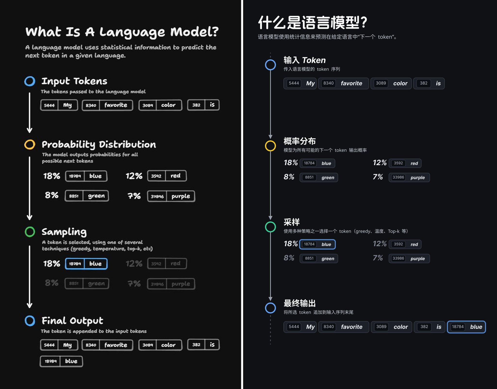

## 信息图转可编辑 SVG

### 概述

无意间发现 GPT 画这种信息图的还原度挺高啊

搞成 SVG 以后还能扔进 Figma 里面改字体，改完就更像了

来源：[X 原帖](https://x.com/op7418/status/1983170448272900480)

### 适配模型

- GPT（ChatGPT）

### 示例



### 提示词

```
指令
请把我发送的图片转成可编辑 SVG：

保持版式与层级结构（标题、分区、图标、箭头、图表等）尽量一致；
所有文字保留为 <text> 可编辑（不要转路径）；

所有图形用向量元素（<rect>/<circle>/<path>/<line>/<polygon>），不要嵌入位图；

颜色与风格尽量接近原图；

分组与命名清晰：01_Header、02_Section_*、Icon_*、Chart_*；

画布尺寸按原图推断；坐标/描边尽量用整数；

生成文件到 /mnt/data/infographic.svg 并给出下载链接。
若图片中有不清晰的内容，请做合理假设并在结果底部列出“假设项”。

（语言：{中文 | 保持原文}）
```
