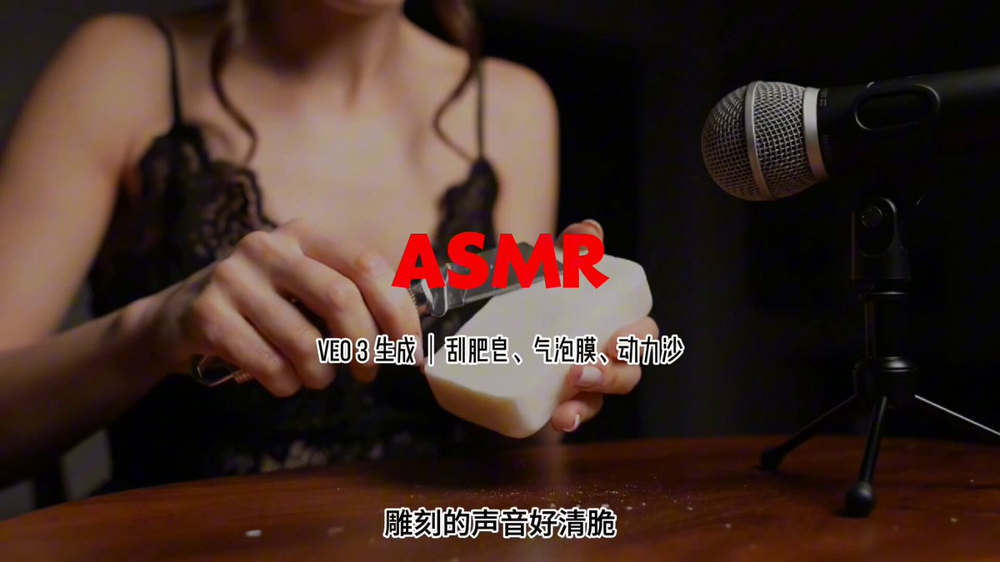

## ASMR 主播口播

### 概述

一个新的即将爆火的 Veo3 ASMR 视频品类

直接模仿 ASMR 主播带上人物口播和物品操作一起

来源：[X 原帖](https://x.com/op7418/status/1935165693521182906)

### 适配模型

- Veo 3

### 示例

原帖为视频，下图为视频封面截图。



### 提示词

```
【画面描述】

ASMR视频，[景别，如：特写镜头/中景/微距镜头/俯拍视角]。一位 [主播的外貌和神态描述，如：长发飘飘的漂亮年轻女性/表情优雅的女士] 身穿 [服装描述，如：丝绸质感的吊带裙/黑色蕾丝上衣]，身处于一个 [场景环境和氛围，如：灯光柔和的卧室/舒适的书房/黑暗极简风格的房间] 中。
一支 [麦克风的描述，如：专业的录音室麦克风/复古的电容麦克风] 被放置在 [麦克风的位置，如：她的面前/离动作非常近的地方]。
她正在与 [核心ASMR道具的描述，如：一大张气泡膜/一块白色的固体香皂/一本皮质封面的日记本] 互动。她 [主播与道具互动的具体动作，如：用手指缓慢地按破每一个气泡/小心翼翼地削下薄薄的皂片/用钢笔在纸上缓缓书写]。镜头的视觉焦点集中在 [画面的主要焦点，如：她的手和道具/香皂的纹理/钢笔尖与纸张的接触点]。

【音频描述】

一个 [主播的音色和语气，如：温柔甜美的女声耳语/低沉平静的耳语/充满亲密感的呼吸声] 说道：“[具体的口播内容，如：‘我们一起来捏破它们吧’/‘听这轻柔的刮擦声’]。”
随后是 [核心ASMR音效的详细描述，使用拟声词和形容词，如：气泡被捏破时清脆响亮的“啪！”声/刀片刮过香皂时发出的酥脆、带有颗粒感的声音/钢笔在纸上书写时独特的、略带刮擦感的“沙沙”声]。
```
