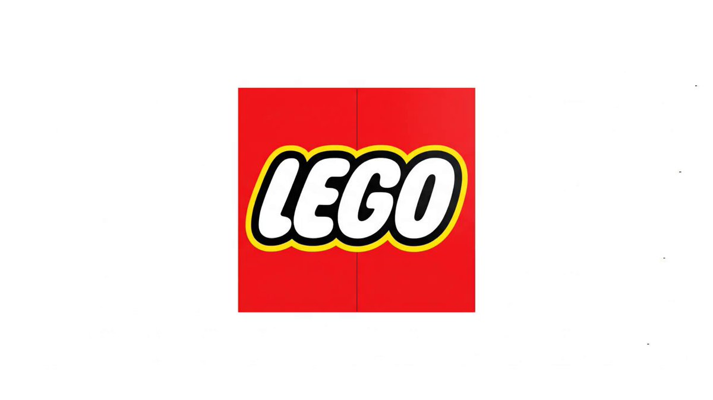

## Logo 分解重组成产品

### 概述

Veo 3 的生命力真的强

这个 logo 无缝衔接变成产品的玩法也很好，非常适合做品牌广告最后一个分镜

照例优化了提示词把 json 格式干掉了

来源：[X 原帖](https://x.com/op7418/status/1947136935648219329)

### 适配模型

- Veo 3

### 示例

原帖为视频，下图为视频封面截图。



### 提示词

```
在一个充满趣味的一镜到底镜头中，经典的乐高标志将分解为无数色彩斑斓的积木颗粒，并在空中自动拼搭成一个充满想象力的模型。

详细场景描述:

画面始于一个纯白背景前，标志性的红色方形乐高（LEGO）标志静静悬浮。整个过程将由一个流畅、不间断的镜头完成。 标志突然轻微晃动，随后“咔”的一声，它分解为“L-E-G-O”四个独立的字母积木。紧接着，这四个字母再次爆开，化作一场五彩斑斓的积木“阵雨”倾泻而下。这些红、黄、蓝、白的标准积木颗粒在空中飞舞、旋转，被一股无形的力量牵引，以极快的速度和精准度相互“咔哒、咔哒”地扣合在一起。镜头可以跟随其中一块关键积木，看它如何找到自己的位置。最终，这些积木在空中完美地拼装成一个活泼的乐高小汽车模型。

核心创意: 标志的解构与充满乐趣的重组。

镜头与运镜: 严格的一镜到底（Single take / One-shot），可以带有趣味性的轻微环绕运镜，以展现拼搭过程的动态感。

整体风格: 充满童趣、活泼、有创造力、令人满足。

灯光: 明亮、均匀、欢快的影棚灯光，让积木的色彩显得格外鲜艳。

环境: 纯白或浅灰色的极简背景，以最大限度地突出乐高积木的色彩。

核心元素:

经典的乐高标志

分解后飞舞的各色积木颗粒

空中自动拼搭的过程

最终成型的乐高模型

音效:

背景音乐: 轻快、俏皮的旋律，可使用木琴、打击乐等乐器。

特效音: 整个过程的核心是乐高积木相互扣合时清脆、悦耳、富有节奏感的“咔哒”声。

结尾: 拼搭完成的乐高模型完美地静置在画面中央。画面淡出为白色。全程无任何文字。
```
