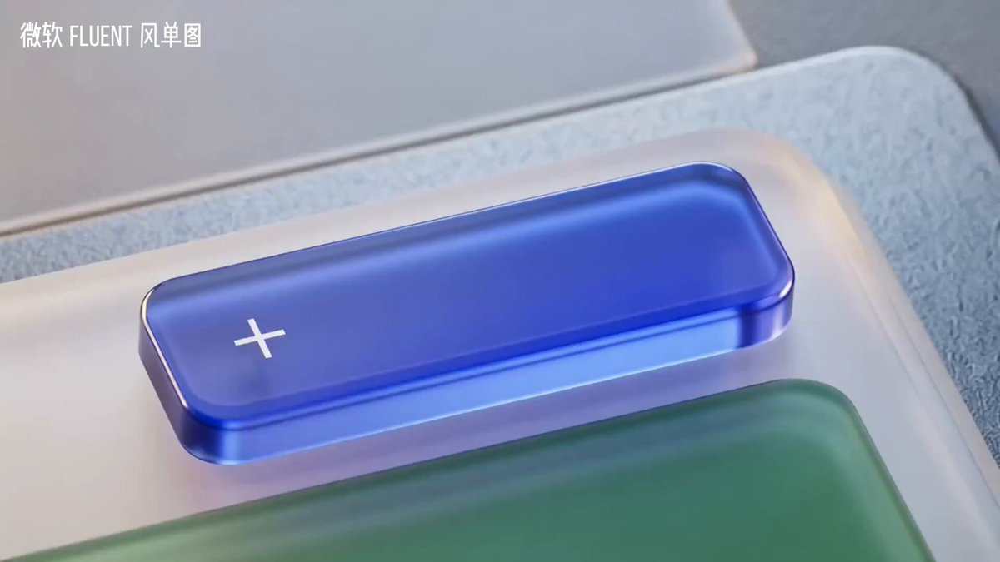

## Seedance 2.0 Fluent 风单图视频

### 概述

将 Nano Banana Pro 或 Seedream 处理后的单张 UI 图片发给 Seedance 2.0。这里单张图片的视觉效果比较好，你可以单独抽卡最后拼接。

来源：[X 原帖](https://x.com/op7418/status/2022721414462374031)

### 适配模型

- Seedance 2.0

### 示例



### 提示词

```
基于 @图片1 帮我生成一个类似微软 Fluent UI 宣传片的亚克力和玻璃质感动效设计视频，用丝滑的动效设计和不同角度的运镜展示 UI 细节，最后无缝过渡到产品名称“Codepilot”
```
