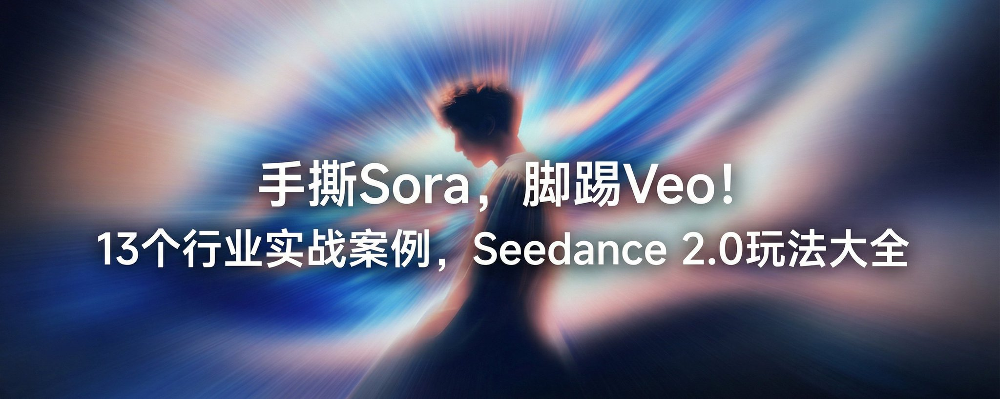

## Seedance 2.0 Fluent 风多图视频

### 概述

将多张处理后的 UI 展示图和 icon 发给 Seedance 2.0，如果你懒得处理，也可以用多张的提示词。还能直接把产品介绍发给他让他帮你连字幕带口播都加上，一键搞定。

来源：[X 原帖](https://x.com/op7418/status/2022721414462374031)

### 适配模型

- Seedance 2.0

### 示例



### 提示词

```
帮我将 @图片6 @图片5 @图片4 @图片3 @图片2 @图片1 这几个 UI 展示图，细节展示和  @ 图片7 icon 变成多分镜多角度的应用宣传片，并搭配合适的口播介绍，为其增加丰富的转场效果和细节展示，每个分镜的转换需要连贯顺畅。 

产品介绍为：CodePilot 是一款 Claude Code 的桌面端，让 Claude Code 更加易用。提供了完善的斜杠命令、第三方 API 支持、可视化的 Skills 和 MCP 配置等功能。 

宣传视频制作思路为：用电影级的 CGI 微距视角，将虚拟界面重塑为精密打磨的实体工业品。 他们打破了扁平化的限制，通过极细腻的材质渲染（如亚克力与玻璃的质感）和光影深度，让图标呈现出可触摸的真实感；同时结合符合物理惯性的动态设计与ASMR 级的触感音效，赋予了像素以重量、弹性与节奏，从而营造出一种既有科技秩序感，又极具温润生命力的“数字实体”美学。类似于 Microsoft 的广告，然后还有比较好的 motion design 和 fluent design，增加玻璃风格的动画。
```
