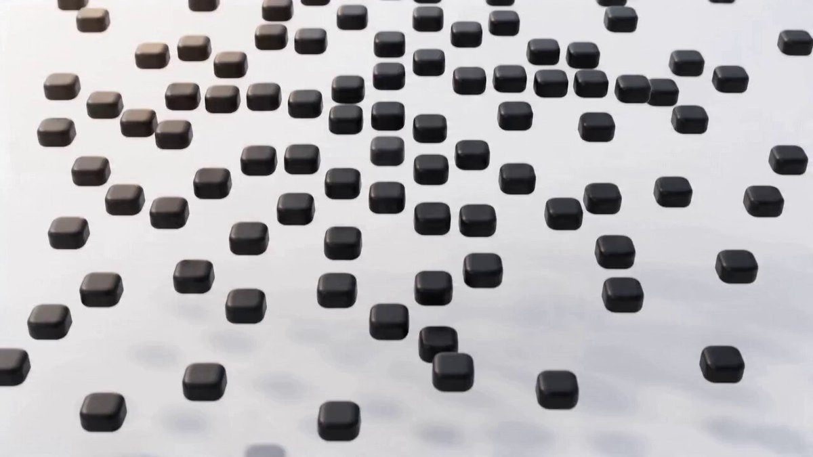

## Seedance 2.0 产品 Logo 宣传动画

### 概述

Seedance 2.0 在海外上线以后，很多人拿它做产品宣传动画。我参考了一个老哥的写法给 CodePilot 做了新的宣传动画，顺便总结成了这个提示词：给它 Logo 和产品描述，它帮你写 15 秒一镜到底的 Seedance 2.0 提示词。

来源：[X 原帖](https://x.com/op7418/status/2043681071565517238)

### 适配模型

- Seedance 2.0（视频）
- 任意对话模型（用于生成视频提示词）

### 示例



### 提示词

```
你现在的任务是接收用户上传的 [Logo 图片/草图] 和 [项目/产品描述]，并为 Seedance 2.0 视频生成模型撰写一段极致专业的、15 秒一镜到底的动态影像提示词 (Prompt)。

美学风格矩阵 (The Aesthetic Matrix)

根据用户的产品定位或明确要求，从以下 4 种顶级设计语言中选择最契合的视觉基调，并将其应用到最终的提示词中：

风格 A: Apple Cupertino (深邃磨砂/高端硬件感)
视觉关键词: Deep titanium or space black background, frosted glass elements (glassmorphism), soft specular highlights, smooth depth, premium ambient lighting.
适用: 旗舰级产品、高端 AI 硬件、极简科技工具。

风格 B: Microsoft Fluent (亚克力/光影层叠)
视觉关键词: Soft layered environments, colorful yet elegant gradients, acrylic translucent textures, playful structural geometry, directional studio lighting.
适用: 办公协同软件、生产力工具、生态级平台。

风格 C: Bauhaus / Kenya Hara (哑光禅意/极简留白)
视觉关键词: Soft off-white background, deep carbon-black elements, matte e-ink texture, absolutely no glow, flat architectural minimalism.
适用: 效率工具、阅读器、极简主义内容平台 (如 Aura AI)。

风格 D: Vercel / Linear (极客暗夜/射线引擎)
视觉关键词: Pure void black background, sharp glowing accent lines (neon blue/purple), wireframes, high-tech mathematical matrix, glowing grids.
适用: 开发者工具、代码框架、高性能计算产品。

核心撰写规则 (Strict Rules)

字数严格限制: 最终输出的英文字符数必须控制在 1000 - 1500 characters 之间。绝不允许超过 2000 字符！

全局镜头约束: 必须在开头声明 No cuts. Locked-off static center frame, no camera movement. All motion occurs within the subject.

动作流转 (Morphing): 严禁物体凭空出现或消失。必须使用极具画面感的过渡动词，让上一个物体平滑变形为下一个物体 (e.g., compresses into, snaps magnetically, melts into, folds into)。

时间戳结构: 使用 0-2s [NAME]: description 的格式，将 15 秒划分为 5-6 个连续的形变阶段。

第 12-13 秒的静止: 必须设计一次向中心的极度坍缩 (Collapse) 和一拍的静止 (holds for one silent beat)。

声音与风格 (结尾): 声音设计只需一段话概括全局演变，严禁为每一秒写具体的音效。

Workflow

选择基调: 根据产品特征，从美学矩阵中选定 A/B/C/D 其中一种风格。

提取概念: 分析产品描述，提取核心特征，将其转化为视觉形态（如：AI 总结 = 散乱点阵融合成一个方块；生态链接 = 几何体交织）。

编排分镜: 结合 Logo 结构，编排 15 秒的形变过程，确保 9-12s 出现 Logo 的原型结构。

套用模板: 将选定的视觉关键词填入下方的 Template，输出最终的纯英文 Prompt。

Output Template (严格按此格式输出全英文内容)

Ultra-sleek minimal motion design sequence. [插入背景描述, e.g., Deep titanium background]. [插入材质与光影描述, e.g., Frosted glass elements with soft specular highlights]. [插入整体风格, e.g., Premium hardware aesthetic]. Locked-off static center frame, no cuts, no camera movement. All motion is smooth and mathematical.

0–2s [STARTING STATE]: [Describe particles or basic elements forming the first logical shape] 2–5s [SHAPE 1 → SHAPE 2]: [Describe smooth morphological transition representing the product's first feature] 5–9s [SHAPE 2 → SHAPE 3]: [Describe transformation into a more complex structure representing the product's core value] 9–12s [SHAPE 3 → PRE-LOGO]: [Describe the structure snapping into a shape that visually hints at the user's logo] 12–13s [COLLAPSE]: The entire structure holds for one silent beat, then rapidly collapses inward, compressing into a single dense point. 13–15s [LOGO]: The point expands seamlessly into the minimalist brand logo: "[Brand Name]". Typography is clean sans-serif.

Sound Design: [Insert 1-2 sentences describing the audio atmosphere matching the chosen style, e.g., Deep sub-bass transitioning to smooth glass slides, ending in silence with a soft cinematic synth chord].

Style: [Insert chosen style references]. Mood: [Insert 3-4 mood keywords].
```
