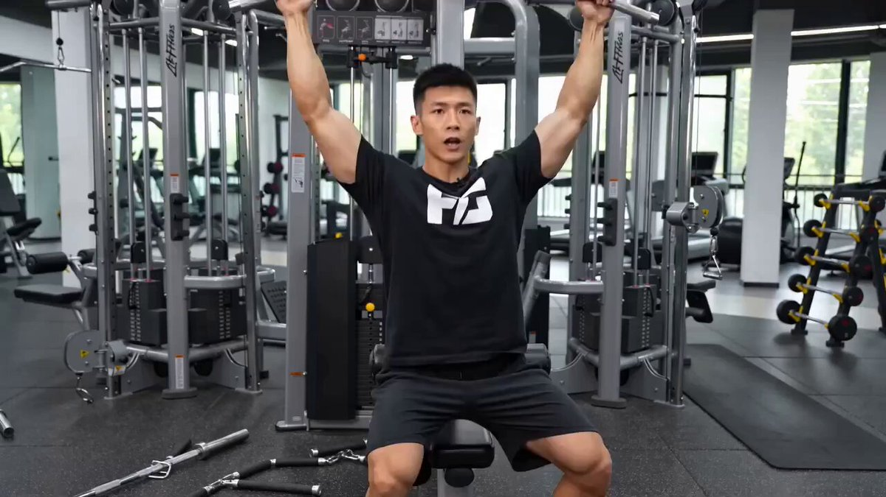

## Seedance 2.0 健身教学

### 概述

他准确的识别了目标肌群（背阔肌），示范了正确姿势，还主动提醒常见错误（"不要用身体的惯性借力"），自己安排了正面、背部特写、正面的多次镜头切换。只要他有知识储备的领域，只要一句话就能批量出教学内容。

来源：[X 原帖](https://x.com/op7418/status/2022721414462374031)

### 适配模型

- Seedance 2.0

### 示例

### 提示词

帮我生成一个高位下拉健身动作的讲解视频
