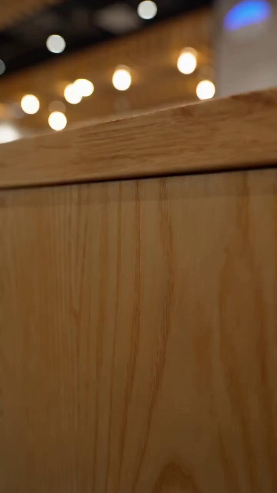

## Seedance 2.0 兰州拉面广告

### 概述

提示词就一句话“生产一个精美高级的兰州拉面广告，注意分镜编排”。没有写任何关于揉面、拉面、浇汤的描述，没有说用慢动作拍面条，模型自己全部安排好了。他甚至选择了慢动作也就是升格摄影来拍捞面的过程。

来源：[X 原帖](https://x.com/op7418/status/2022721414462374031)

### 适配模型

- Seedance 2.0

### 示例

### 提示词

生产一个精美高级的兰州拉面广告，注意分镜编排
