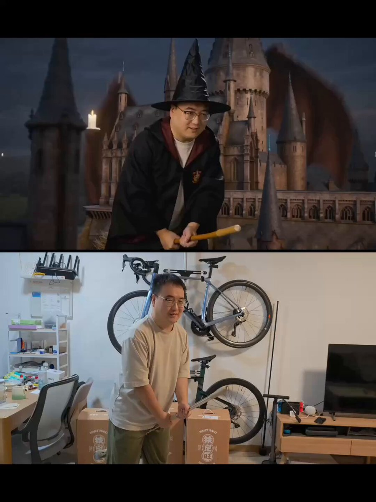

## Seedance 2.0 动作迁移：魔法扫帚

### 概述

真人实拍动作迁移到任意特效场景。人物相对摄影机是静止的，世界在运动，加上 CAMERA MOUNTED ON JOHN 等关键词后才能保持动作。

来源：[X 原帖](https://x.com/op7418/status/2022721414462374031)

### 适配模型

- Seedance 2.0

### 示例



### 提示词

```
一名面部非常像@视频1角色的魔法师骑着魔法扫帚在魔法城堡的上空躲避巨龙的追逐，魔法师的动作和运镜需要与@视频1 完全一致，镜头需要适中跟踪魔法师，CAMERA MOUNTED ON JOHN，LOCKED-ON SHOT，FIXED-TO-ACTOR
```
