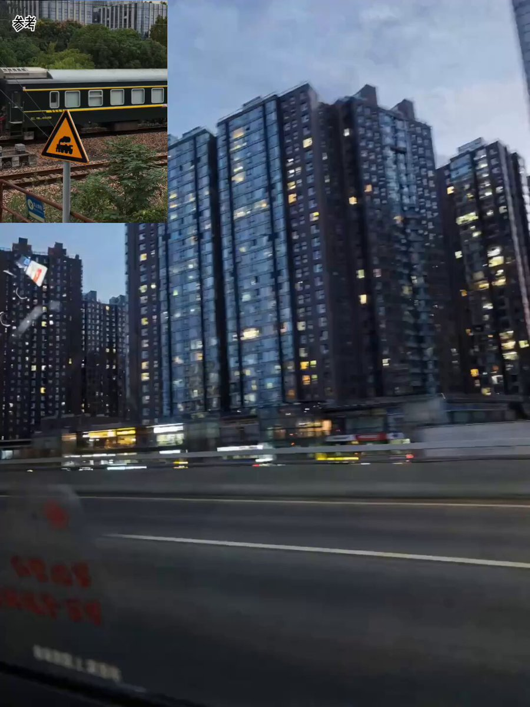

## Seedance 2.0 参考 Vlog 风格

### 概述

用参考Vlog+自己的照片，一键生成同风格的日常Vlog。如果提示词不写原来 Vlog 的一些特色他就学的不太好。

来源：[X 原帖](https://x.com/op7418/status/2022721414462374031)

### 适配模型

- Seedance 2.0

### 示例



### 提示词

```
参考 @视频1 的运镜、画面切换节奏、画面颜色风格、音乐和卡点，文字和特效，用剩下的图片变成一个日常 Vlog。这种风格的主要特色是：其核心在于利用高密度的硬切剪辑与ASMR级别的环境拟音（Foley），将原本平庸琐碎的日常画面强行卡入音乐的鼓点律动中；视觉上通过动态跟踪3D立体文字植入现实景观，并运用拟人化手绘涂鸦给无生命物体赋予情绪与灵魂。
```
