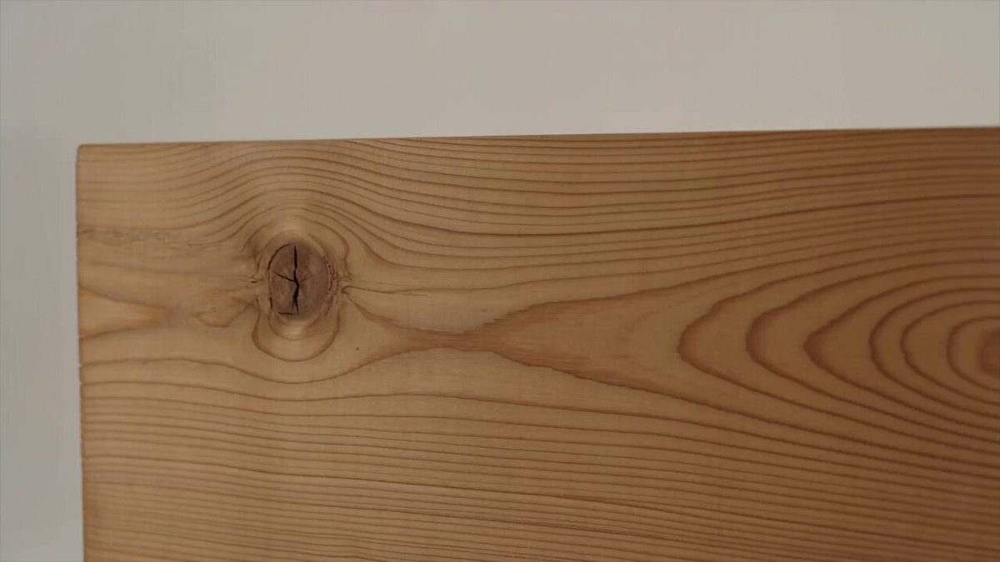

## Seedance 2.0 品牌宣传片（无印良品）

### 概述

它自己选择了极简风格的画面（木质纹理特写、椅子设计、家居空间）。自己写了品牌哲学口播词，配乐选了极简钢琴。模型完全理解了 MUJI（无印良品） 的品牌DNA。

来源：[X 原帖](https://x.com/op7418/status/2022721414462374031)

### 适配模型

- Seedance 2.0

### 示例

### 提示词

帮我生成一个讲述无印良品这个品牌的宣传片
