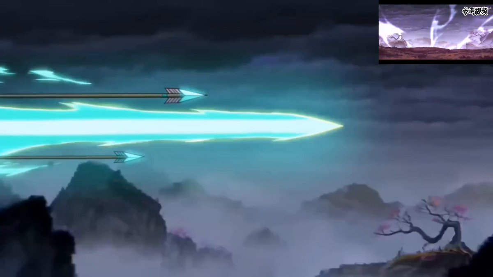

## Seedance 2.0 小说原文生成动漫

### 概述

直接发一段小说原文他就能精准的生成对应的视频。这里添加了几秒的《雾山五行》动画参考，让风格变得比较国风和独特。

来源：[X 原帖](https://x.com/op7418/status/2022721414462374031)

### 适配模型

- Seedance 2.0

### 示例



### 提示词

```
帮我根据下面的小说剧情要求生成动漫，将画风动作打斗表现严格对齐 @视频1 的风格。 
剧情要求为： 第三支箭离开大瑶山。一粒光点从本尊身上跃出，附着于「桃都」之上，以剑遁之术破空飞遁。第三支箭瞬息即至烂桃山。 道士屈指一弹，弹出两道蝌蚪光点，一黑一白，两者交织飞旋，化作一个太极图，太极图外再生八卦，化作一个八角八卦镜框的圆心铜镜。仙镜飞出烂桃山，迸发神光，拦在巨箭之前。 箭锋顿时停滞。 但见这支神箭止住之后，在那团浓郁的幽碧色飞虹尾迹中，还有一支箭！第四支箭藏在了第三支箭的飞虹尾迹中....
```
