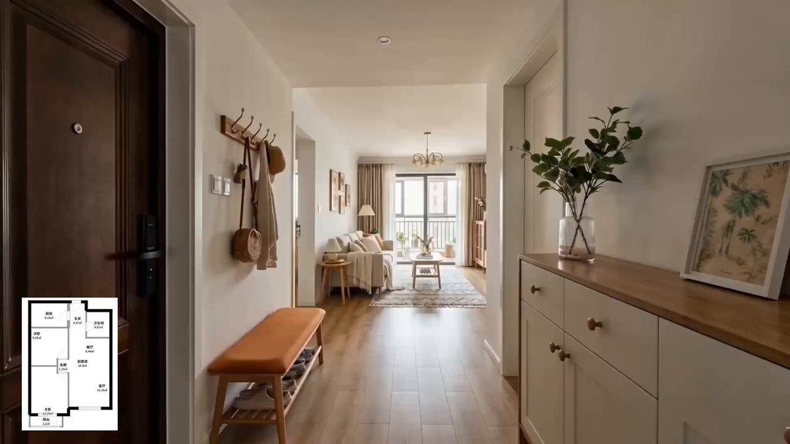

## Seedance 2.0 户型图样板间参观视频

### 概述

户型图变沉浸式样板间参观视频。生成九宫格分镜之后直接把户型图和分镜图一起发给 Seedance 2.0。原来的分镜图和分镜图上的文字都没有在生成的视频中出现，空间布局、各个区域和房间的相对位置都跟户型图是一致的。

来源：[X 原帖](https://x.com/op7418/status/2022721414462374031)

### 适配模型

- Seedance 2.0

### 示例



### 提示词

```
参考 @图片2设计稿分镜和@图片1户型图，生成一段沉浸式的样板间参观视频，严格按照@图片2 的分镜顺序生成视频，模拟真实看房的行走路线，可以切镜头，注意自然光线变化和材质质感
```
