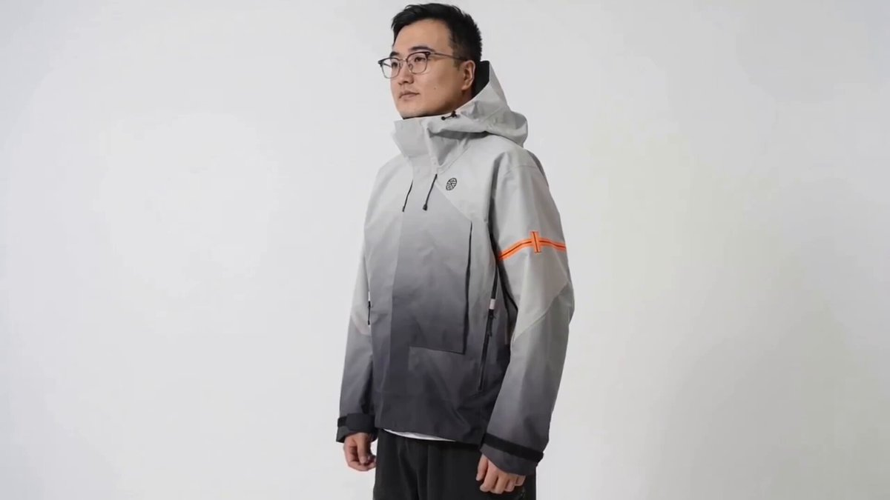

## Seedance 2.0 服装换装展示

### 概述

人像+衣服照片，生成带运镜的换装展示视频。他直接将三套服装依次展示，自动安排了中景全身、胸口标志特写、拉链特写、正面展示的镜头切换，配了动感电子音乐。注意：目前限制了真人主体参考，必须经过本人验证或取得授权。

来源：[X 原帖](https://x.com/op7418/status/2022721414462374031)

### 适配模型

- Seedance 2.0

### 示例



### 提示词

```
让 @图片4 的男性分别换上 @图片1 @图片2 @图片3 的三套服装进行展示，每次展示一套，需要有不同景别的流畅运镜和转场切换，加上符合服装设计的调性的广告音乐
```
