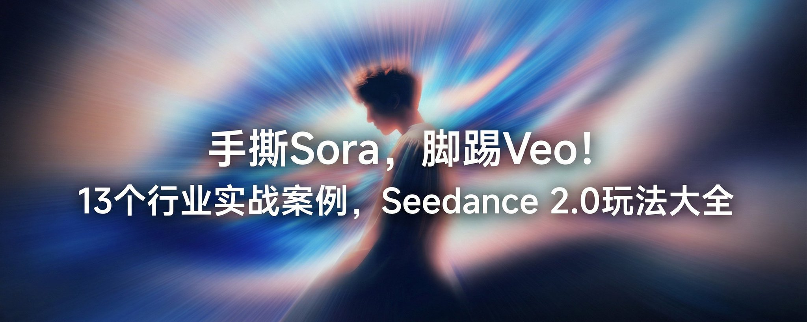

## Seedance 2.0 行业实战提示词合集

### 概述

Seedance 2.0 玩法大全文章里 13 个行业案例的提示词：餐饮广告、品牌宣传片、健身教学、UI 宣传片、服装换装、家装样板间、Vlog、视频播客、音乐 MV、动作迁移、小说转动漫。在有常见知识的情况下“写意图、不写细节”。

来源：[X 原帖](https://x.com/op7418/status/2022721414462374031)

### 适配模型

- Seedance 2.0
- Nano Banana Pro / Seedream（UI 包装和九宫格分镜图片）

### 示例



### 提示词

#### 兰州拉面广告

生产一个精美高级的兰州拉面广告，注意分镜编排

#### 品牌宣传片（无印良品）

帮我生成一个讲述无印良品这个品牌的宣传片

#### 健身教学

帮我生成一个高位下拉健身动作的讲解视频

#### 微软 Fluent 风 UI 包装（图片，Nano Banana Pro / Seedream）

```
为这张 UI 设计稿添加类似于微软 UI 宣传片的包装，不要丢失原有内容，具体要求为一种“数字材质感”。他们不再把屏幕看作一张纸（像 Material Design 那样），而是看作一个有深度、有光影的三维空间。
光感 (Light): 光不仅仅是照明，更是引导。视频中常利用点光源、边缘光（Rim Light）来勾勒物体的轮廓，制造焦点。
材质 (Material): 这是最显著的特征。他们大量使用亚克力 (Acrylic) 材质——即带有磨砂玻璃质感的半透明效果，以及类似陶土、金属和硅胶的物理材质感。
深度 (Depth): 强调 Z 轴的概念。UI 元素不是平铺的，而是分层的，通过阴影和视差滚动来体现层级关系。2. 视觉表现特点：微距与质感 (Macro & Tactility)
这些宣传片最迷人的地方在于它们把 UI 图标当成了实体工业产品来拍摄。
极度微距摄影视角: 镜头往往贴得非常近，让你看到图标边缘的倒角、材质表面的细微颗粒（Noise）。这种“微距美学”让虚拟的软件界面产生了真实的触摸欲望。
完美的 CMF 设计: 借鉴工业设计中的 CMF（颜色、材质、表面处理），每个图标仿佛都是精心打磨的工艺品。例如 Word 的蓝色不再只是一个色块，而是一块有厚度、有光泽的蓝色类玻璃物体。
光线追踪渲染: 视频呈现出极高水准的渲染质量，特别是通过半透明材质（磨砂玻璃）透出来的漫射光，营造出一种高级、温润的氛围。
```

#### Fluent 风单图视频

```
基于 @图片1 帮我生成一个类似微软 Fluent UI 宣传片的亚克力和玻璃质感动效设计视频，用丝滑的动效设计和不同角度的运镜展示 UI 细节，最后无缝过渡到产品名称“Codepilot”
```

#### Fluent 风多图视频

```
帮我将 @图片6 @图片5 @图片4 @图片3 @图片2 @图片1 这几个 UI 展示图，细节展示和  @ 图片7 icon 变成多分镜多角度的应用宣传片，并搭配合适的口播介绍，为其增加丰富的转场效果和细节展示，每个分镜的转换需要连贯顺畅。 

产品介绍为：CodePilot 是一款 Claude Code 的桌面端，让 Claude Code 更加易用。提供了完善的斜杠命令、第三方 API 支持、可视化的 Skills 和 MCP 配置等功能。 

宣传视频制作思路为：用电影级的 CGI 微距视角，将虚拟界面重塑为精密打磨的实体工业品。 他们打破了扁平化的限制，通过极细腻的材质渲染（如亚克力与玻璃的质感）和光影深度，让图标呈现出可触摸的真实感；同时结合符合物理惯性的动态设计与ASMR 级的触感音效，赋予了像素以重量、弹性与节奏，从而营造出一种既有科技秩序感，又极具温润生命力的“数字实体”美学。类似于 Microsoft 的广告，然后还有比较好的 motion design 和 fluent design，增加玻璃风格的动画。
```

#### 服装换装展示

```
让 @图片4 的男性分别换上 @图片1 @图片2 @图片3 的三套服装进行展示，每次展示一套，需要有不同景别的流畅运镜和转场切换，加上符合服装设计的调性的广告音乐
```

#### 家装九宫格分镜（图片，Nano Banana）

```
基于当前的户型图，为我设计一套九宫格的样板间参观视频分镜图。
分镜图需要严格遵循以下顺序，所有的照片都从门口的玄关进入，依托于这个坐标点拍摄。
从玄关看向右手的厨房，看向左手的卫生间，再到客厅，最后到主卧和次卧
它的空间关系要跟这个户型图对应哈，风格得是这种温馨的北欧风格。
```

#### 户型图样板间参观视频

```
参考 @图片2设计稿分镜和@图片1户型图，生成一段沉浸式的样板间参观视频，严格按照@图片2 的分镜顺序生成视频，模拟真实看房的行走路线，可以切镜头，注意自然光线变化和材质质感
```

#### 参考 Vlog 风格

```
参考 @视频1 的运镜、画面切换节奏、画面颜色风格、音乐和卡点，文字和特效，用剩下的图片变成一个日常 Vlog。这种风格的主要特色是：其核心在于利用高密度的硬切剪辑与ASMR级别的环境拟音（Foley），将原本平庸琐碎的日常画面强行卡入音乐的鼓点律动中；视觉上通过动态跟踪3D立体文字植入现实景观，并运用拟人化手绘涂鸦给无生命物体赋予情绪与灵魂。
```

#### 视频播客

```
使用@图片1的人物和环境，然后使用@音频1作为人物的声音内容，生成一个视频播客视频，需要加上字幕，适当的给@音频1一些情感表现让他更真实和激动
```

#### 音频生成爱情故事

```
为@音频1生成符合氛围的有点遗憾的爱情电影剧情，需要有情节，保持@音频1作为视频背景音乐，转场间画面风格及音乐节奏进行卡点
```

#### 动作迁移：魔法扫帚

```
一名面部非常像@视频1角色的魔法师骑着魔法扫帚在魔法城堡的上空躲避巨龙的追逐，魔法师的动作和运镜需要与@视频1 完全一致，镜头需要适中跟踪魔法师，CAMERA MOUNTED ON JOHN，LOCKED-ON SHOT，FIXED-TO-ACTOR
```

#### 动作迁移：高科技长矛战士

```
一名面部非常像@视频1角色的人类高科技战士拿着高科技长矛枪在跟外星生物战斗，战士的动作和视频运镜与@视频1一致
```

#### 小说原文生成动漫

```
帮我根据下面的小说剧情要求生成动漫，将画风动作打斗表现严格对齐 @视频1 的风格。 
剧情要求为： 第三支箭离开大瑶山。一粒光点从本尊身上跃出，附着于「桃都」之上，以剑遁之术破空飞遁。第三支箭瞬息即至烂桃山。 道士屈指一弹，弹出两道蝌蚪光点，一黑一白，两者交织飞旋，化作一个太极图，太极图外再生八卦，化作一个八角八卦镜框的圆心铜镜。仙镜飞出烂桃山，迸发神光，拦在巨箭之前。 箭锋顿时停滞。 但见这支神箭止住之后，在那团浓郁的幽碧色飞虹尾迹中，还有一支箭！第四支箭藏在了第三支箭的飞虹尾迹中....
```

#### 延长视频

将 @视频1 延长 15s，具体信息为：XXXX
