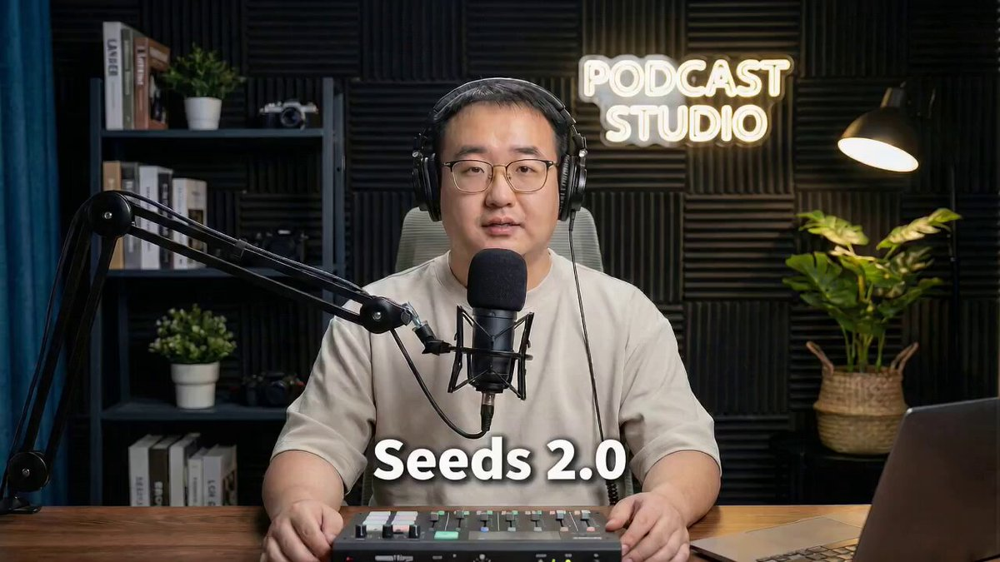

## Seedance 2.0 视频播客

### 概述

只提供一张照片和一段音频，就能生成有镜头变化的视频播客。图像保证人像一致性，音频保证声音一致性。

来源：[X 原帖](https://x.com/op7418/status/2022721414462374031)

### 适配模型

- Seedance 2.0

### 示例



### 提示词

```
使用@图片1的人物和环境，然后使用@音频1作为人物的声音内容，生成一个视频播客视频，需要加上字幕，适当的给@音频1一些情感表现让他更真实和激动
```
