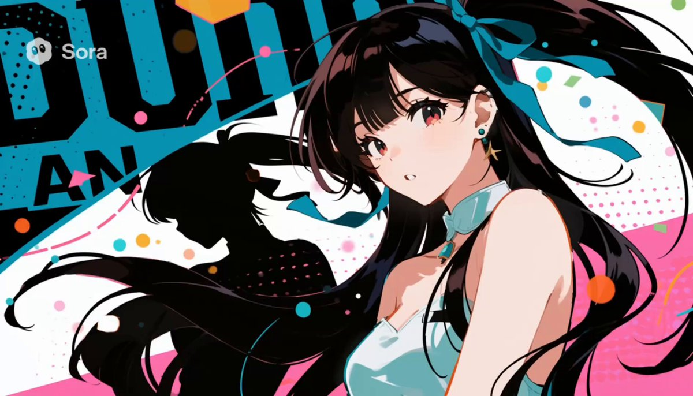

## Sora 2 动漫 OP

### 概述

很多朋友都想问我昨天的 Sora 2 动漫视频是怎么做的

这几天完善了一下提示词，教一下大家，而且你还能上传首帧图片去控制画面风格，让 Sora 2 生成的角色和风格更漂亮

起因是前几天 ZHO 分享了一下 852 用 Sora 2 做的动漫 OP 视频就跟 Gemini 讨论了一下里面的元素

来源：[X 原帖](https://x.com/op7418/status/1977254592200294517)

### 适配模型

- Sora 2
- 即梦 3.1（首帧）

### 示例

原帖为视频，下图为视频封面截图。



### 提示词

#### 提示词 1

```
日本动漫开场曲，拥有美丽的角色，中文歌词，传达良好的世界观，以及非常现代且充满活力的美学风格，类似于动态杂志排版或波普艺术。它结合了高对比度的角色剪影、网点图案和大量动态排版，创造出非常动感且视觉冲击力强的序列。
```

#### 提示词 2

```
动漫美女，美学风格非常现代且充满活力，像动态的杂志版面或波普艺术。将高对比度的人物剪影与半色调图案以及大量动感排版相结合，没有文字
```

#### 提示词 3

```
比如可以这样：

anime opening features a highly stylized aesthetic that is clearly graphic design-inspired, blending principles of motion graphics with a modern, urban feel. The visuals are defined by high-contrast imagery, often using a monochrome with an accent color palette to make the character silhouettes and screentone patterns pop. This is combined with bold kinetic typography and abstract geometric shapes. The pacing is intense and energetic, driven by fast-paced editing and moments of impressive sakuga, where exaggerated motion creates an incredibly dynamic and fluid experience.
```
