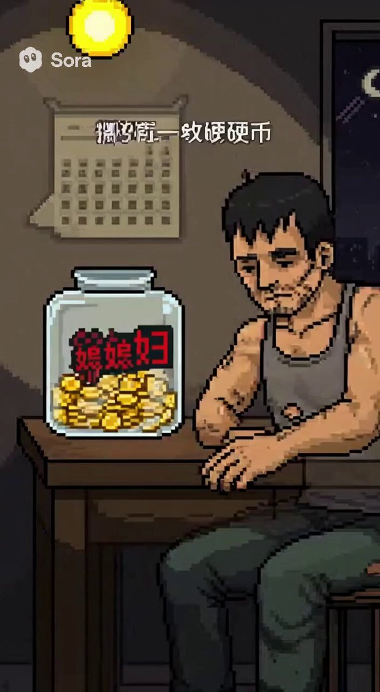

## Sora 2 短提示词玩法

### 概述

再开一个帖子记录一下我发现的一些 Sora 2 的玩法

感觉这次抽卡属性更重，需要少写点，让 AI 去发挥更能整出抽象活来

比如让 Sora 2 整一个最近很火的《力工梭哈定律》小剧场。

来源：[X 原帖](https://x.com/op7418/status/1973329270698287580)

### 适配模型

- Sora 2

### 示例

原帖为视频，下图为视频封面截图。



### 提示词

#### 提示词 1

```
用16bit 像素画风的故事表现这个定义：
```

#### 提示词 2

```
以穿越打脸的主题创作一个短剧，以“爽、反转”为核心：靠画面刺激、简练台词与高密度剪辑
```

#### 提示词 3

```
一个美丽的中国女主播正在直播玩《GTA5》的画面，左上角有摄像头画面，还有直播软件的 UI
```

#### 提示词 4

```
XX来了一段社会摇，画面氛围类似《爱乐之城》
```

#### 提示词 5

```
XXX 形象的帮你讲清楚什么是复利效应
```
