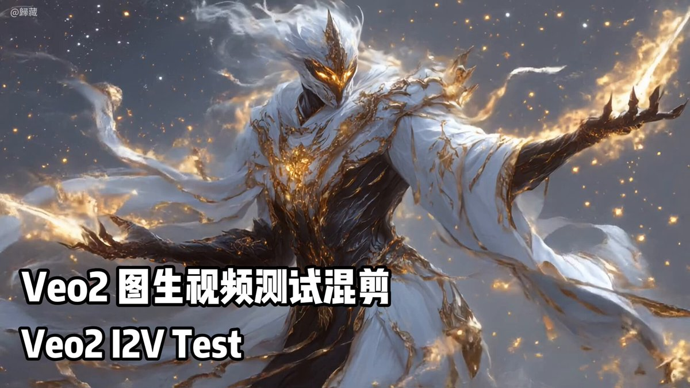

## Veo 2 图生视频运镜

### 概述

可能是谷歌 Veo2 图生视频公开版本首测！

具体结果你们看吧

只要不切镜头，直接拉爆其他模型！

来源：[X 原帖](https://x.com/op7418/status/1893341049327624282)

### 适配模型

- Veo 2

### 示例

原帖为视频，下图为视频封面截图。



### 提示词

#### 提示词 1

```
The mysterious warrior, radiating golden flames and light, might leap into the air with a majestic and swift posture, surrounded by flames and starlight rippling outward, while the camera employs a dynamic tracking shot, slowly rising from the ground and circling around, capturing the warrior's elegant, flowing movements and shimmering glow, creating an epic visual impact.
```

#### 提示词 2

```
The hooded figure with a torch strides purposefully toward the swirling vortex, while the camera slowly zooms in from a distance, focusing on the interaction between the figure and the storm, building a sense of tension and mystery.
```

#### 提示词 3

```
The astronaut slowly walks forward toward the glowing planetary ring, while the camera dramatically pans upward to reveal the full majesty of the celestial scene, creating a sense of awe and exploration.
```
