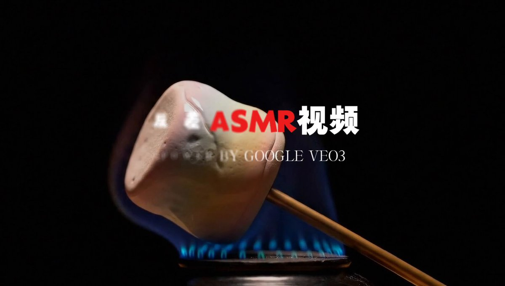

## 切割玻璃水果 ASMR

### 概述

近期另一个爆火的 AI 视频品类

一些日常不好实现的 ASMR 视频，比如切割各种玻璃金属材质的水果

搞了一套提示词实现了一下，需要用到 Veo 3 的文生视频

来源：[X 原帖](https://x.com/op7418/status/1934462664186736913)

### 适配模型

- Veo 3

### 示例

原帖为视频，下图为视频封面截图。



### 提示词

```
ASMR video of slicing a glass strawberry: From an extreme macro viewpoint, a flawlessly transparent, hyper-detailed glass strawberry sits on a warmly lit wooden cutting board.

 The camera gently pushes in and out, capturing iridescent highlights and rainbow refractions dancing across its surface. Angles alternate between overhead and 45-degree side shots, freezing the exact moment the knife meets the brittle “fruit” and revealing delicate internal striations. 

Each slow, deliberate cut releases a crisp ding—the fragile chime of shattering glass—followed by the soft clatter of tiny shards and the low, resonant scrape of steel against wood, layering a rich ASMR soundscape in an otherwise hushed room. 

Composition follows the rule of thirds, with the strawberry anchored at a golden-ratio point; the background melts into a dreamy bokeh of warm light and floating dust motes. Overall, the palette is clear and serene, immersing viewers in the mesmerizing textures of glass fracturing and the intimate, crystalline sound of every slice.
```
