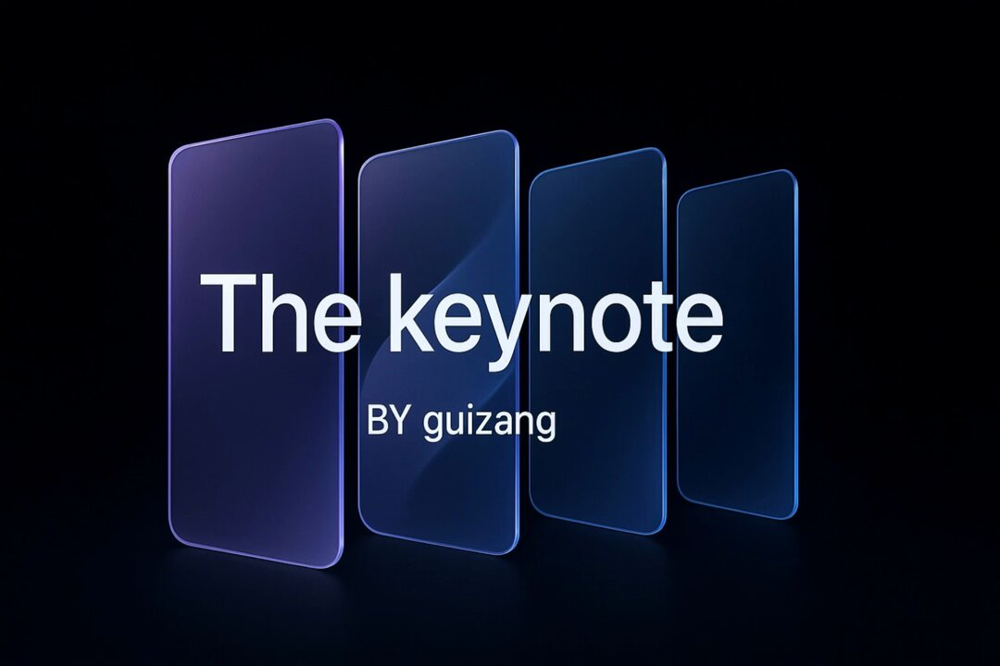
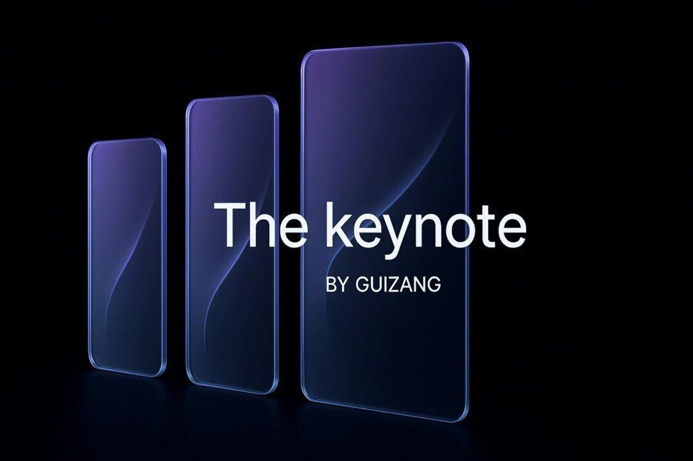
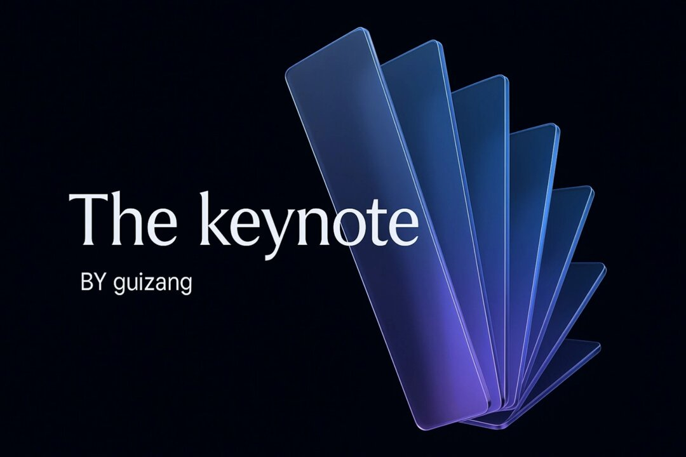
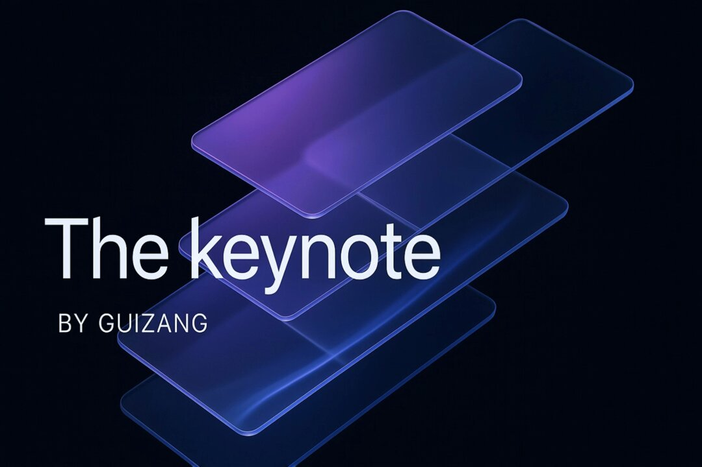

## 动态 PPT 背景与循环动画

### 概述

这老哥用 Lovart 做的 PPT 封面视频很不错

但是他是零碎的聊天记录，我整理成了提示词可以稳定一键生成多个漂亮的 PPT 封面

在 Lovart 和星流 Agent 都可以用

来源：[X 原帖](https://x.com/op7418/status/1943608769117606309)

### 适配模型

- Lovart
- 星流 Agent

### 示例

原帖为视频，下图为视频封面截图。






### 提示词

```
藏师傅的动态 PPT 背景设计与动画制作提示词

为主题演讲创建一系列带有动态图形的背景设计和循环动画，具体要求如下：

**基础设计要求：**
- 使用模型：image-1 和 Kling 2.1
- 画面背景：纯黑色填充整个画面
- 画面比例：16:9
- 主要元素：半透明玻璃面板效果（在黑色背景上的视觉效果）
- 面板特征：
  - 细长的玻璃卡片质感，具有半透明效果
  - 面板之间略有重叠
  - 锐利清晰的边缘
  - 干净现代的3D数字渲染
- 设计风格：简约优雅，苹果风格设计语言
- 视觉效果：柔和的渐变和反射，形成流动的弧线

**颜色方案：**
- 主色调：蓝色系为主
- 渐变效果：紫罗兰色到蓝色的渐变
- 保持所有版本使用相同的配色方案
- 在纯黑背景上营造深邃而优雅的视觉氛围

**构图变化版本：**
1. 从左到右轻微弧形排列
2. 从右到左弧形排列
3. 居中对称排列
4. 扇形发散排列
5. 交错层叠排列

**文字元素：**
- 主标题：使用Outfit字体，大号文字显示"The keynote"
- 副标题：小号文字显示"BY guizang"
- 文字处理：文字作为画面的一部分，与玻璃面板效果和谐融合
- 文字可带有微妙的发光或反射效果

**动画要求：**
- 动画类型：无缝循环动画
- 动画速度：缓慢流畅的运动
- 循环特性：动画结束时回到起始位置，实现完美循环
- 动画效果建议：
  - 玻璃面板的缓慢漂浮或旋转
  - 光线在面板间的流动
  - 渐变色的微妙变化
  - 反射光的移动
  - 面板之间的相对位置变化
- 动画时长：5 秒完成一个循环

**交付要求：**
1. 每种构图的静态预览图（完整画面）
2. 每种构图的循环动画文件（完整画面）
3. 保持所有版本的视觉一致性和专业感
4. 所有输出都是带有黑色背景的完整作品

重要说明**：**
请创建完整的画面作品，黑色背景是画面的一部分，不要生成需要后期合成的透明素材或抠图效果。
```
