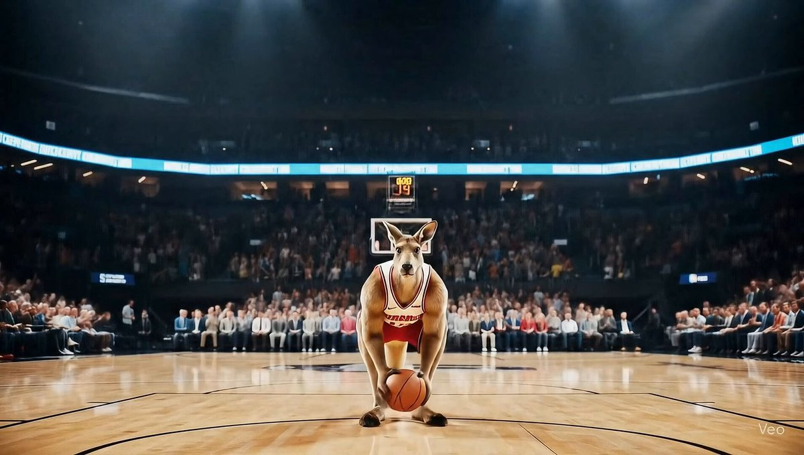

## 动物运动员

### 概述

咋动物运动员又火了，原推快700万曝光了

用 Veo3 跑了一个袋鼠打篮球和猫咪击剑运动

来源：[X 原帖](https://x.com/op7418/status/1936670100687610085)

### 适配模型

- Veo 3

### 示例

原帖为视频，下图为视频封面截图。



### 提示词

```
[Animal Name/Type] [performs a specific, dynamic sporting action].

This cinematic, [Shot Type, e.g., slow-motion, dynamic tracking shot] is set inside a [Detailed Venue Description, e.g., professional basketball arena]. The venue features [Key Environmental Details, e.g., a polished court, bright overhead lights, and a cheering crowd]. The air is filled with the sounds of [describe key sounds, e.g., sneakers squeaking on the court, the roar of the crowd, and the animal's determined grunt]. The [Animal Name/Type], wearing [Specific Gear/Attire, e.g., a numbered jersey and tiny sneakers], shows an expression of [Specific Emotion, e.g., intense concentration]. The camera captures the moment it [Describes the detailed movement, e.g., leaps into the air with incredible power], showcasing its [Key Attribute, e.g., surprising grace or raw strength]. The [Lighting Description, e.g., dramatic spotlights] highlight [Final visual details, e.g., the tension in its muscles and the determined look in its eyes].
```
