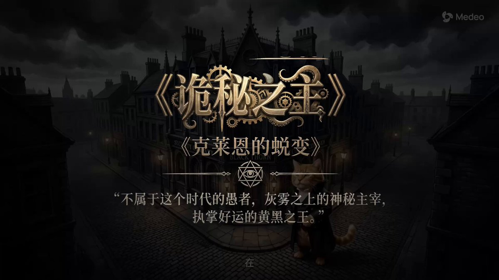

## 哈基米风格小说影视剧解说

### 概述

最近各种哈基米风格重新演绎经典小说和影视剧的内容爆火。刷到好多几十万赞的视频。

我抽象了一下他们的创作方式，然后整理成了 Medeo 的提示词

这个目前非常容易起号，建议有想法的可以赶紧行动一波

这里用哈基米风格重新演绎诡秘之主里克莱恩第一卷的蜕变过程

来源：[X 原帖](https://x.com/op7418/status/2001125632718331939)

### 适配模型

- Medeo

### 示例

原帖为视频，下图为视频封面截图。



### 提示词

```
请启动全流程视频创作模式，基于我提供的经典影视剧或小说《诡秘之主》的剧情逻辑和关键的一段剧情，制作一段风格独特的第三方叙事视频，先检索或者在知识库中查找这个小说或者影视剧的经典桥段或者世界观。

首先，请深入分析我上传的参考图片中的角色形象（例如耄耋、企鹅、奶龙、噜噜等），提取它们的生物特征与神态，生成图片的时候，务必要保证它们的（面部和身体）露出服装外面的部分要与原图完全一致，用Gemini生成图片的时候，不要把名字写到提示词里，就只说根据我上传的参考图生成什么什么图片就行，防止名称误导模型并利用你的知识库检索原著作品中主角与反派的经典造型。你需要将这些萌宠角色无缝代入原著角色的身份，要求它们身着原著中极具辨识度的古装、战甲或现代戏服，衣物材质要有布料或金属的真实纹理，只有头部或者漏出的身体采用 Meme 的形象，服装还是原著的服装。但身体比例和脸部特征保持原有的萌系或滑稽感，形成一种强烈的反差萌。

画面风格方面，采用水墨风格迪士尼皮克斯风格的2.5D高品质渲染。需要使用 Gemini 生成图片，角色装扮需要符合原著，光影要明亮且富有通透感，使用次表面散射（SSS）技术表现角色皮肤或毛发的细腻质感，背景采用微缩景观般的精致建模，色彩饱和度适中，营造出一种像是置身于高昂动画电影中的视觉体验。

剧情构建与分镜生成上，根据我提供的剧情内容，务必保证叙事的完整，不要偷懒节省图片和镜头，镜头语言要流畅，多使用缓慢的推拉镜头来强调情绪的转变，必须以耄耋这只猫咪为主角，其他群众也是猫咪的样子，主要配角选择“奶龙”、“噜噜”或者“企鹅”。

最后，也是最关键的，请生成一段第三人称的旁白口播文案，并配上深沉但略带反差的纪录片式男声。文案必须严格遵守以下“哈气和哈基米”的语言体系：将所有人类种族或家族称为“某某咪”（如萧咪、纳兰咪）；将所有的攻击、斗气、内力或魔法或者权谋斗争统一称为“哈气”；在描述剧情的关键道具的时候，在道具名称后加上“南北绿豆”这个词作为完整的道具名称；将原本严肃的修炼等级或地位描述得像是在几个 Meme 打架。旁白语调要一本正经地胡说八道，配合画面中萌宠们严肃又滑稽的表演，完成对原著经典桥段的解构与重塑。

具体的文章内容为： XXXXX
```
