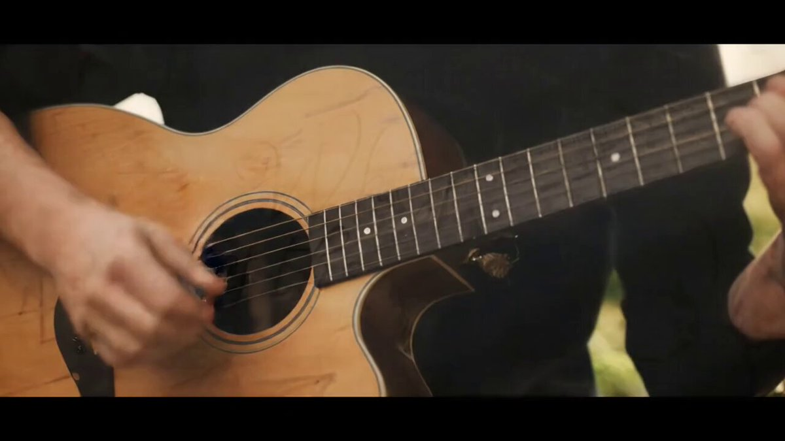
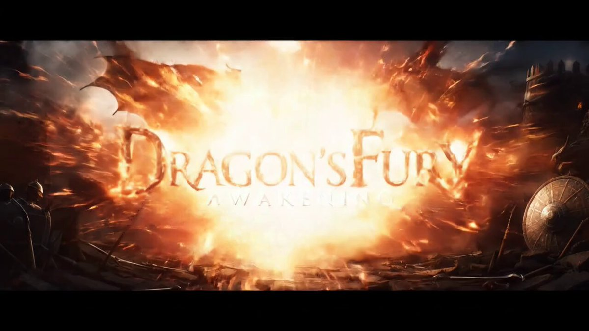
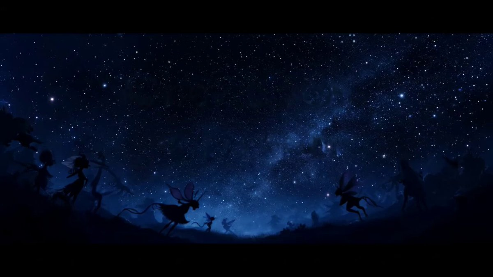

## 文字标题动画

### 概述

Veo 3 做文字动画视频也太强了

这下以后宣传视频的开头不用发愁了，做出来的动画都非常应景，而且还有对应的音效

来源：[X 原帖](https://x.com/op7418/status/1925453298506809744)

### 适配模型

- Veo 3

### 示例

原帖为视频，下图为视频封面截图。






### 提示词

```
A playful, hand-drawn animation shows 'Sweet & Savory Delights' and then 'Hosted by Chef Alex' appearing on a rustic wooden cutting board surrounded by fresh ingredients like tomatoes and herbs, upbeat ukulele music, a warm and inviting kitchen setting

A shimmering, ethereal light writing animation spells out 'Once Upon a Dream' followed by 'Chapter One: The Enchanted Forest' against a magical, starlit sky with glowing particles and whimsical creatures subtly moving in the background, enchanting harp music and soft chimes, a sense of wonder and magic.

An explosive, fiery animation for the game title 'Dragon's Fury Awakening' followed by 'Available Now!' against a backdrop of a war-torn medieval battlefield with dragons flying overhead, epic orchestral music with battle drums, intense and action-packed

A delicate, ink wash animation brings forth the words 'Whispers of the Wild' then 'A New Collection' appearing on textured, parchment-like paper with subtle animated vines and flowers blooming around the text, calming acoustic guitar music, soft natural light filtering through.
```
