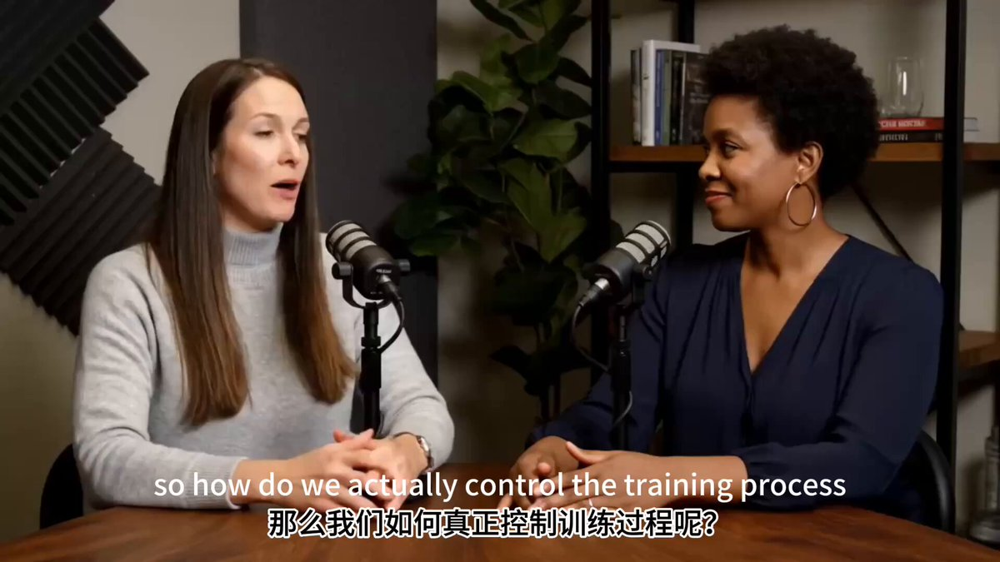

## 真人播客对话

### 概述

Veo 3 直接生成真人播客对话视频，还能指定主题

这要再长点，直接把视频编排 Agent 干死了，果然最后一切都是模型

来源：[X 原帖](https://x.com/op7418/status/1925033354023600486)

### 适配模型

- Veo 3

### 示例

原帖为视频，下图为视频封面截图。



### 提示词

```
一个播客录制场景，两位女性主持人正在讨论有关大语言模型（LLM）训练主题的内容，其中一位提问，另一位解答。
```
