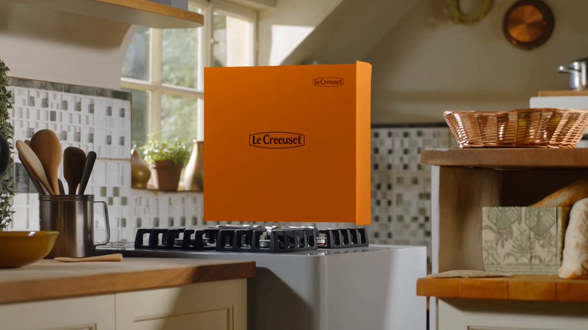
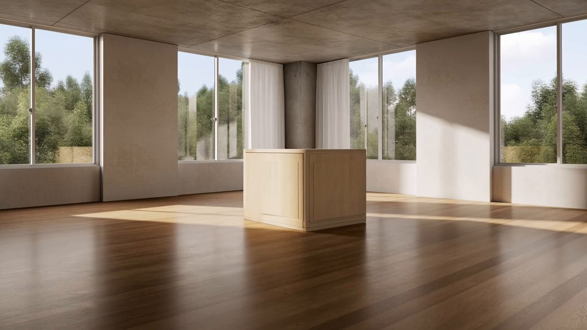
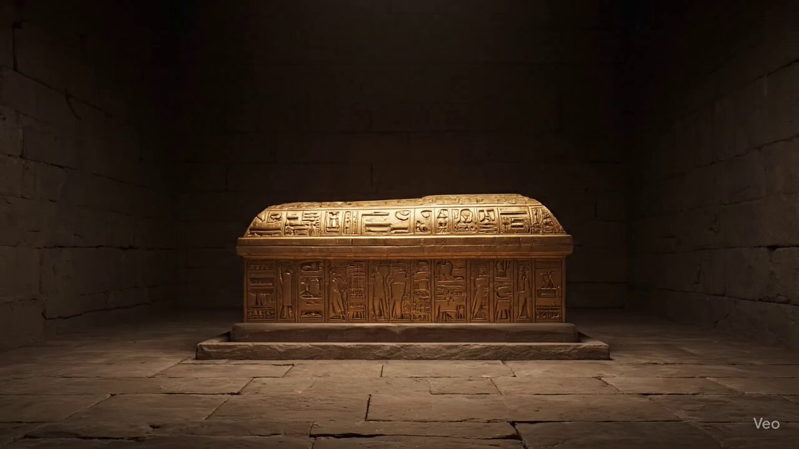
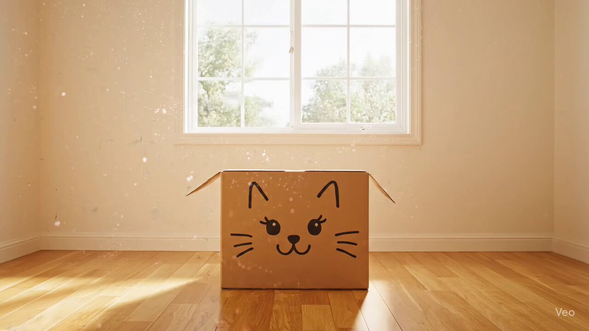

## 纸箱飞出物品组成房间

### 概述

这个从箱子里飞出产品，然后组成房间的点子，太好了表现力超强！

我优化了一下提示词，加了防止切镜头和去掉了json格式

来源：[X 原帖](https://x.com/op7418/status/1946771466823008541)

### 适配模型

- Veo 3
- 海螺

### 示例

原帖为视频，下图为视频封面截图。






### 提示词

```
提示词，发给 AI 让他改成你想要的主题就行：

Camera Instruction : Single fixed camera, wide-angle lens, one continuous shot, no camera cuts or movement.

Main Description : The scene begins in a sunny, empty room. In the center sits a cardboard box with a cute cat face drawn on it with a marker. The box wiggles slightly, lets out a soft meow, and then bursts open! Countless yarn balls, scratching post parts, soft cushions, and cat toys gush out. A giant cat tree grows rapidly from the floor like a real tree, complete with leafy platforms; a scratching post wraps itself with sisal rope and stands in a corner; feather wands dance through the air before landing in a toy basket. Once everything is perfectly in place, a fluffy orange cat walks in with elegant steps, curiously observing its new paradise, and finally curls up comfortably on a soft cushion.

Core Elements : Cardboard box with a cat face, large cat tree, scratching posts and pillars, various cat beds and cushions, wall-mounted cat shelves, a window hammock, an automatic water fountain, cat toys (feather wands, jingle balls, toy mice), a rug with a paw-print pattern.

Motion & Atmosphere : Full of playful fun and whimsy, various cat supplies assemble automatically in a lively, charming way, ultimately creating a warm, cozy, and safe paradise built perfectly for a cat.

Keywords : 16:9, one take, no cuts, dynamic assembly, photorealistic, cat, cute, cat room, pet paradise, heartwarming, no text.
```
