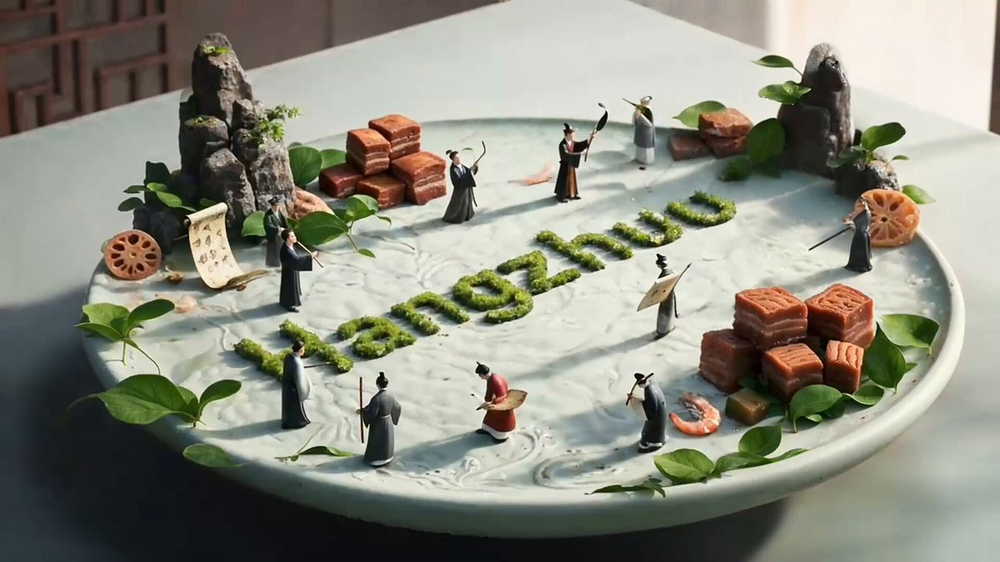

## 美食城市微缩动态海报

### 概述

试了一下没想到真行！Veo 做的城市微缩景观动态海报

收到海辛昨天视频的启发，把刚才的图片提示词改了一下变成了动态海报

来源：[X 原帖](https://x.com/op7418/status/1927638407741915377)

### 适配模型

- Veo 3

### 示例

原帖为视频，下图为视频封面截图。



### 提示词

```
Time-lapse photography style, the culinary scene unfolds gradually from nothingness in a time-lapse manner. Various ingredients and miniature elements grow and assemble step by step, eventually forming a complete isometric 3D miniature landscape. Vibrant red chili peppers and emerald green Sichuan peppercorns are artfully arranged to spell out the English word "Chengdu."

The specific landscape description is as follows: A bubbling hot pot of spicy oil and adorable panda elements create a world of numbing heat and aromatic flavors—miniature diners gather around a giant copper-style hot pot (chopping board), with ingredients like bamboo shoots, shiitake mushrooms, tripe, and tofu skin transforming into rolling hills. The spicy oil converges into a meandering river, dotted with tofu skin boats. Mini pandas made of glutinous rice balls or mochi play in a nearby bamboo forest (composed of celery or cilantro stems).
```
