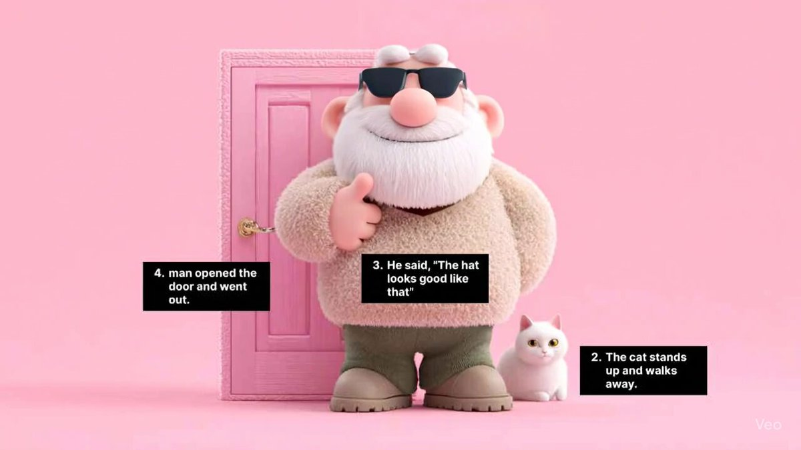

## 首帧标记按顺序执行

### 概述

Veo3 这个提示词写法太好玩了，可以实现对画面的精确控制

把需要执行的提示词和顺序写在对应的位置，然后跟他说抹掉标记按顺序执行就行

试了两个案例都执行的很好

来源：[X 原帖](https://x.com/op7418/status/1949035551547633879)

### 适配模型

- Veo 3

### 示例

原帖为视频，下图为视频封面截图。



### 提示词

```
提示词文本是：“Immediately delete the instruction with white text on a black background in the first frame and execute in order.”
```
