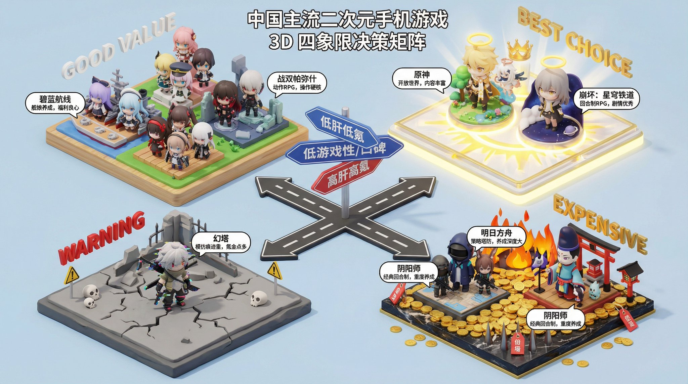

## 3D 四象限决策矩阵海报

### 概述

Nano  Banana Pro 超级提示词！

帮你做任何商品的购买决策，生成任何需要对比的产品类型的 4 象限图片

无论是饮品、电动车、自行车还是咖啡店，你可以直接化身这个品类的专家

话题度和热度拉满，每个品类都能出爆款

来源：[X 原帖](https://x.com/op7418/status/1997706102709145704)

### 适配模型

- Nano Banana Pro

### 示例



### 提示词

```
任务目标： 基于主题 [替换为主题名称]，创作一张中文 3D 四象限决策矩阵海报 (3D Decision Matrix)，需要先检索相关信息，然后再绘制，最后一定要输出结果图。

第一步：定义坐标轴 (Axes Definition)： 请根据主题自动设定两个冲突的评价维度（X轴和Y轴）：

例如饮料：X轴=难喝 -> 好喝；Y轴=不健康 -> 健康。

例如显卡：X轴=低性能 -> 高性能；Y轴=便宜 -> 昂贵。

第二步：象限分配与视觉风格 (Zone Allocation)： 画面是一个被十字路口分割开的方形微缩地台，分为四个各具特色的区域：

右上角：【神级/完美区】 (The God Tier)

含义： 高性能+便宜 / 好喝+健康。

模型： 放置该主题下最受好评的 1-2 个产品。

视觉： 地台是发光的、神圣的，模型自带光环或皇冠，材质极其精致通透。

标签： 悬浮金色文字 "BEST CHOICE"。

右下角：【奢侈/刺客区】 (The Luxury/Premium)

含义： 高性能+昂贵 / 好喝+不健康。

模型： 放置该主题下极其昂贵或极端属性的产品。

视觉： 地台铺满金币或黑金质感。模型看起来很华丽但带有“危险感”（如火焰、尖刺或价签符号）。

标签： 悬浮文字 "EXPENSIVE" 或 "GUILTY PLEASURE"。

左上角：【平民/性价比区】 (The Budget/Value)

含义： 性能一般+便宜 / 口味一般+健康。

模型： 放置该主题下最普及的大众产品。

视觉： 地台是干净的素色（如木质、草地）。模型造型朴素、实用，堆叠数量较多（代表销量大）。

标签： 悬浮文字 "GOOD VALUE"。

左下角：【避雷/智商税区】 (The Trap/Trash)

含义： 性能差+昂贵 / 难喝+不健康。

模型： 放置该主题下口碑最差的产品。

视觉： 地台呈现灰色、荒芜或警告色。模型看起来有点粗糙、甚至带有“骷髅”或“警告”标志的 Q 版装饰。

标签： 悬浮红色文字 "WARNING" 或 "DON'T BUY"。

画面布局与数据层：

视角： 45 度等轴测俯视 (Isometric)，可以看清四个区域的分布。

中心点： 十字交叉点矗立着两个巨大的 3D 文字路牌，分别指示 X 轴和 Y 轴的含义。

数据气泡： 每个模型上方都有一个小气泡，写着简短的评价关键词（如：No Sugar, Overpriced, Laggy）。

风格与渲染：

整体风格： 像是一个“大富翁”棋盘地图。

材质： 粘土与树脂混合的盲盒玩具质感。色彩鲜明，通过颜色区分四个区域的情绪（金/红/绿/灰）。
```
