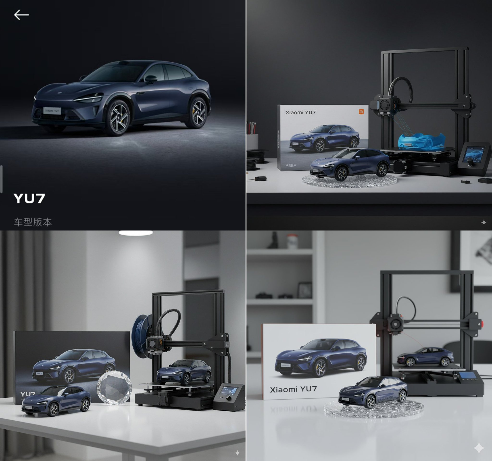

## 3D 打印机旁的汽车手办

### 概述

好像现在Nano Banana手办又多了一个背后是 3D打印机的版本？

用我的汽车订单截图转了几张，确实看起来比Blender应景一些，而且还会出现正在打印的半成品效果更真实了

下面👇有提示词

来源：[X 原帖](https://x.com/op7418/status/1962046237026443422)

### 适配模型

- Nano Banana

### 示例



### 提示词

```
提示词，注意关于汽车和品牌的词自己用的时候需要更换：

Please transform this car rendering into a collectible figurine. 

Behind it, place a figurine box printed with the car's image and the name "Xiaomi YU7." Next to it, add a high-end 3D printer that is currently printing the figurine. In front of the figurine box, add a round plastic base for the figurine to stand on. 

The PVC material of the base should have a crystal-clear, translucent texture, and set the entire scene indoors.
```
