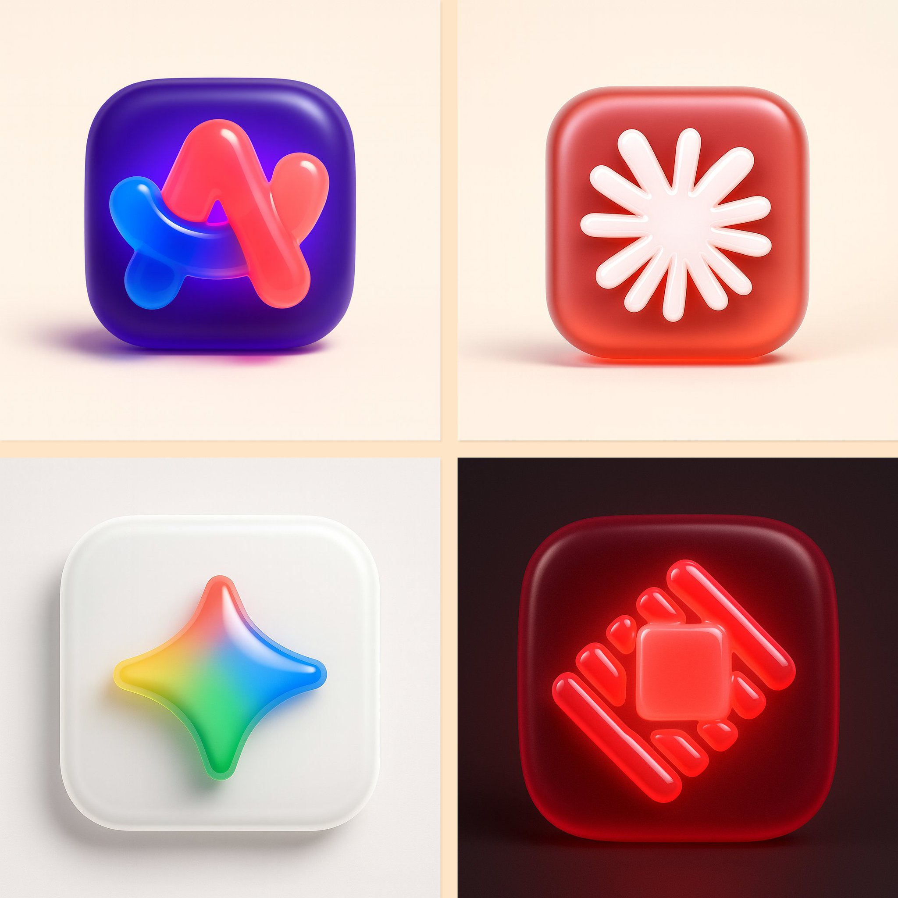

## 3D 果冻图标

### 概述

这个可以做 3D 果冻风格图标的 4o 提示词真不错

把 Raycast、Claude、ARC 和 Gemini 图标转换了

我改了一下他的提示词，去掉了 json 格式，变成了中文，删掉了废话，整体稳定了一些。

来源：[X 原帖](https://x.com/op7418/status/1951230699283141075)

### 适配模型

- GPT-4o

### 示例



### 提示词

```
帮我把这张图改为 3D 果冻图标风格

风格定义
整体风格：果冻 3D 图标
应用对象：用户上传的标志图片或emoji

底座设计
形状：圆角正方形
材质：柔软的半透明果冻状材质
颜色：选择与图标形成强烈对比的颜色
光效：内部发光效果，配合向外柔和渐变的环境阴影

图标设计
材质：果冻/玻璃质感的半透明外观，从内部柔和发光
颜色：使用更明亮的色调或品牌色，始终保持果冻玻璃质感
深度：3D 挤出效果，边缘圆润，底部有细微阴影
位置：在底座内居中放置，四周留有均匀的内边距
渲染设置
相机视角：正面正交视图，构图居中
灯光效果：工作室品质照明，左上方柔和高光，图标下方有方向性投影

阴影设置
风格：柔和扩散的底部阴影，带有轻微模糊
位置：位于图标正下方，略微向下偏移
不透明度：15%
扩散范围：中等，与同系列其他图标保持一致

输出规格
背景：柔和的暖灰色或粉彩奶油色，保持一致性
尺寸：1:1 正方形比例

重要提示
确保整套图标的光照和阴影柔和度保持一致。阴影应该出现在图标的下方和后方，带有柔和的模糊效果——完全匹配 Spotify、相机和天气图标样本。避免生硬或过于锐利的阴影。通过阴影和深度效果强调图标与底座之间的清晰分离。
```
