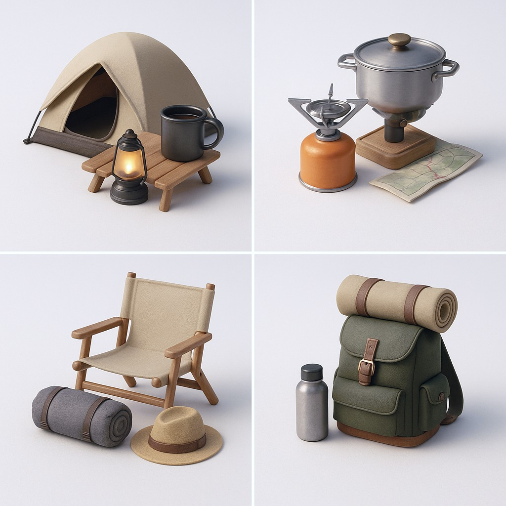
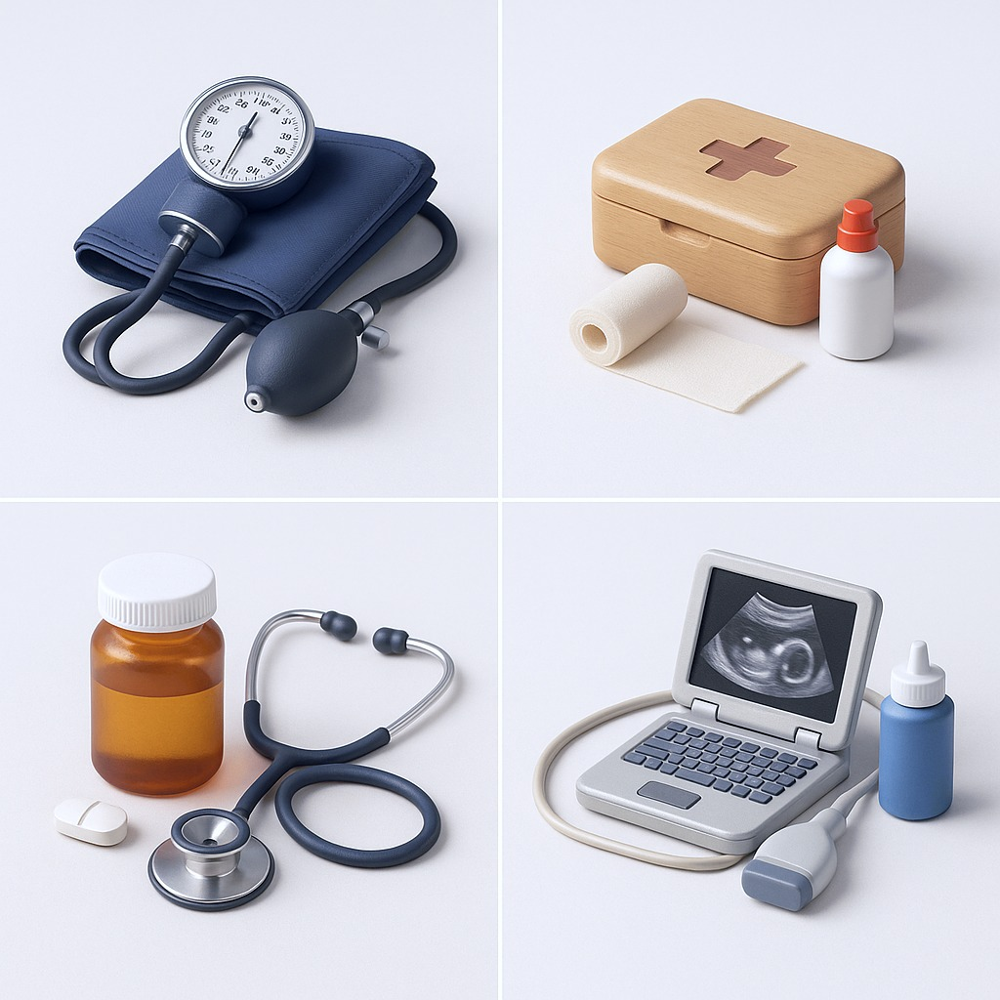

## Airbnb 拟物微缩图标

### 概述

Airbnb 昨天发布了他们的新版 UI 和开始支持生活服务了

这套有点像早期 iOS 设计的拟物图标太好看了！

来源：[X 原帖](https://x.com/op7418/status/1922496821332414839)

### 适配模型

- GPT-4o

### 示例




### 提示词

```
提示词（搭配图片使用）：

生成一套 1:1 比例的 4 宫格高品质医疗服务图标集图片，每个图标是一个由多个相关物品组成的微缩场景，风格参考我上传的 Airbnb 新版图标图片，强调真实材质与细腻光影，具有木材、金属、塑料、织物等材质细节。整体采用柔和打光、轻拟物风格，构图干净、空间紧凑，没有过度使用圆润边角，像一组摆放在白色桌面上的迷你立体模型。统一视角、柔焦背景、无人物干扰，呈现精致、可信、具备情绪感染力的服务场景图标，整体风格3D渲染，像是早期 iOS 拟物化设计的图标，具有梦幻感，使用 C4D制作，材质有光泽感，图片上不要有文字。
```
