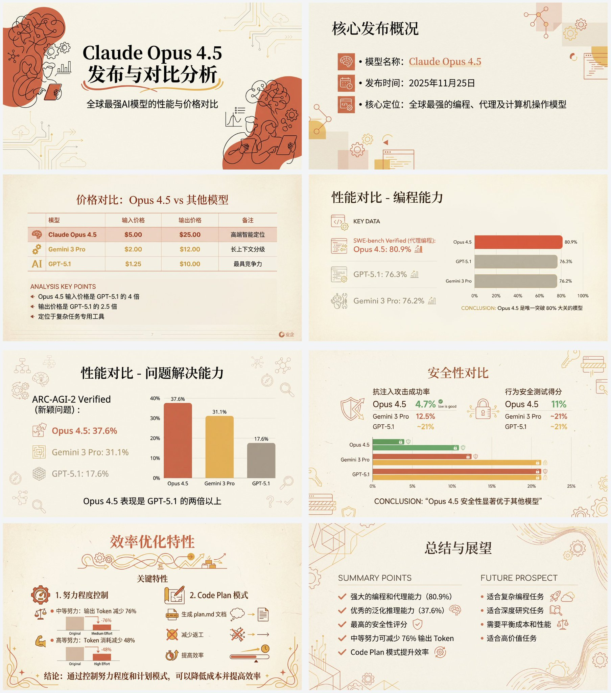

## Anthropic 风格的PPT生成

来源：[X 原帖](https://x.com/op7418/status/1993159387796718006)

### 适配模型

- Nano Banana Pro

### 示例

### 提示词

帮我根据下面这个文章做一套中学生都能理解的中文PPT。

先写1个PPT大纲，规划出每一页的PPT的内容。

然后将每一页的PPT内容分别扔给Nana Banana pro生成对应页面的PPT，需要确保风格一致。

PPT的具体风格应该为请“Anthropic/Claude 风格”的“温暖学术人文主义”设计。

背景：使用暖米色/奶油色 (# F3F0E9) 作为底色，模仿高级纸张质感。

字体：标题使用优雅的衬线体（Serif），正文使用现代无衬线体（Sans-serif）。

配色：主色调为赤陶红 (# D67052) 和芥末黄 (# F0B857)，搭配深海军蓝作为点缀。避免使用霓虹色或纯黑色。

视觉元素：使用注重排版的网格布局，插图风格应为抽象的、有机的黑色手绘线条画，置于赤陶红纯色色块之上，部分关键信息使用卡片布局。

图表：扁平化、极简的柱状图，强调数据对比，去除多余边框。

文字和图像都由 Nano Banana Pro 生成，另外不要将PPT 变成一整张图，一页一张图。

文章内容为：