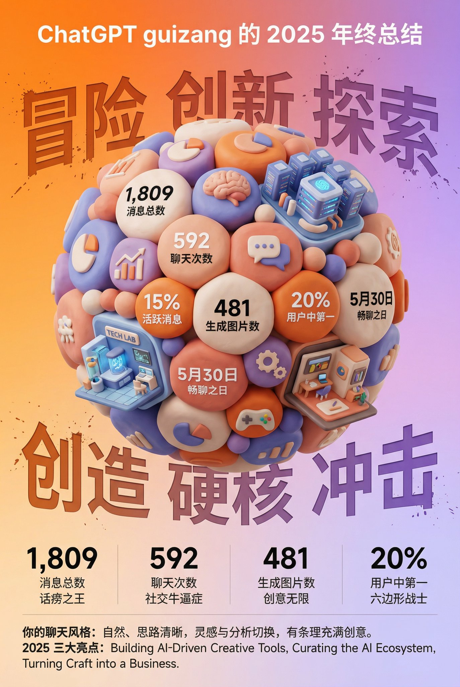

## ChatGPT 年终总结分享图

### 概述

Open AI 这个年终总结不行，藏师傅给他补一下

🍌 Nano Banana Pro 提示词：

为你的 ChatGPT 年终总结做一张分享图

Open AI 这个年终总结还是没国内大厂专业，分享图该有的信息都没有，我自己用大香蕉搞了一套提示词

把你的总结截图和提示词扔给 Nano Banana 就行

来源：[X 原帖](https://x.com/op7418/status/2003318596722724917)

### 适配模型

- Nano Banana Pro

### 示例



### 提示词

```
任务目标：
基于用户同时上传的年终总结截图中的数据和信息，设计一张风格鲜明、极具视觉冲击力的 3D 年终总结海报，用户名 [guizang]

整体风格与情绪（固定风格）：
核心风格： 融合 3D 趋势、游戏化元素和高饱和度色彩。
材质感： 画面主体呈现精致的黏土（Clay）或软塑胶材质渲染，边缘圆润，光影柔和，给人一种“盲盒玩具”的亲切感。

排版感： 整体布局要像一份精致的高级杂志，疏密有致，信息架构清晰。文字排版简洁明了，不要添加任何卡片、胶囊或底框类的装饰背景。

画面主体（核心视觉）：
视觉中心是一颗巨大的、紧密堆叠的 Q 版 3D 黏土球体。球体的组成元素需要根据用户上传截图中的具体内容来动态生成：

数据气泡： 将截图中提取的关键数字和对应的标签（例如：消息总数、聊天次数、生成图片数、活跃度排名等）制作成圆润的黏土数据气泡嵌入球体。

主题图标： 根据截图体现的用户兴趣点，添加相应的通用黏土图标（例如：游戏手柄、大脑、图表、对话气泡等）。

类别建筑（核心要求）： 分析截图中的内容侧重点，在球体中融入几座代表不同聊天品类的精致微缩黏土建筑。例如：
如果包含 AI/技术内容，加入一座带有科技感的未来数据中心建筑。
如果包含游戏内容，加入一座像素风格的游戏城堡。
如果包含创意/艺术内容，加入一个微型艺术工作室。
组合方式： 所有这些元素（气泡、图标、建筑）必须非常紧密、融洽地挤在一起，无缝组成一个完美的球形，不露出内部结构。

背景设计（固定框架）：
底色： 采用高饱和度的暖橙色到柔和紫色的渐变背景（参考之前的风格）。

背景文字： 在星球背后，放置六个巨大的、带有喷溅纹理和反向蚀刻效果的汉字，主题可以是“冒险 创新 探索”（上排）和“创造 硬核 冲击”（下排），部分被球体遮挡，增加街头硬核感。

信息架构与排版（内容从截图中提取）：
顶部 (Header)： 放置白色的 ChatGPT Logo，并根据截图信息生成标题，格式为：“[从截图中提取的用户名] 的 [年份] 年终总结”。

底部数据区 (Data Grid)： 在球体下方，创建一个极简的 2x2 纯文字数据网格。从截图中选取 4 个最核心的数据，使用超粗无衬线字体展示大数字，并配上相应的文字标签和有趣的社交属性短语（例如：“社交牛逼症”、“话痨”、“六边形战士”等，依据数据特性生成）。
页脚总结 (Footer)： 在最底部用小字排版两段文字，内容直接从用户截图中的总结段落（如“你的聊天风格”和“年度亮点”）提取。
```
