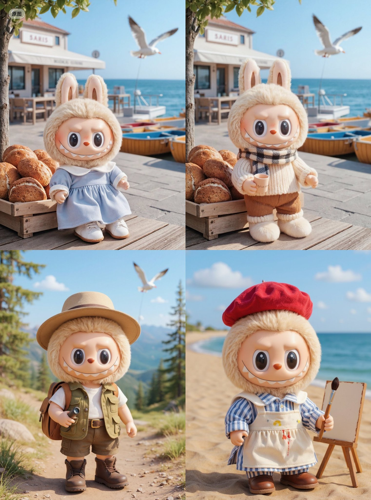

## Labubu 换装

### 概述

尝试用 FLUX Kontext 给 Labubu 换装，太可爱了！

来源：[X 原帖](https://x.com/op7418/status/1930184877628108845)

### 适配模型

- FLUX Kontext

### 示例



### 提示词

```
Dress it in a khaki adventure vest with multiple pockets, layered over a simple white T-shirt and brown cargo shorts. Top it off with a wide-brimmed sun hat and swap the shoes for a pair of durable mini hiking boots. For added detail, accessorize with a vintage-style miniature binocular or a small canvas backpack, as if it's filled with treasures from a journey.

A chunky, hand-knitted sweater in a cream or oatmeal color, paired with a classic plaid scarf. For the lower body, corduroy trousers would be perfect, with a pair of fluffy snow boots on its feet. If possible, add a miniature hand-warmer or a tiny cup of "hot cocoa" in its hand

A red beret, worn tilted to one side, is essential. Dress it in a classic blue and white striped shirt (Breton shirt), covered with an off-white canvas apron that has a few "accidental" paint splatters on it. Holding a miniature easel and a tiny paintbrush would complete the artistic temperament perfectly.
```
