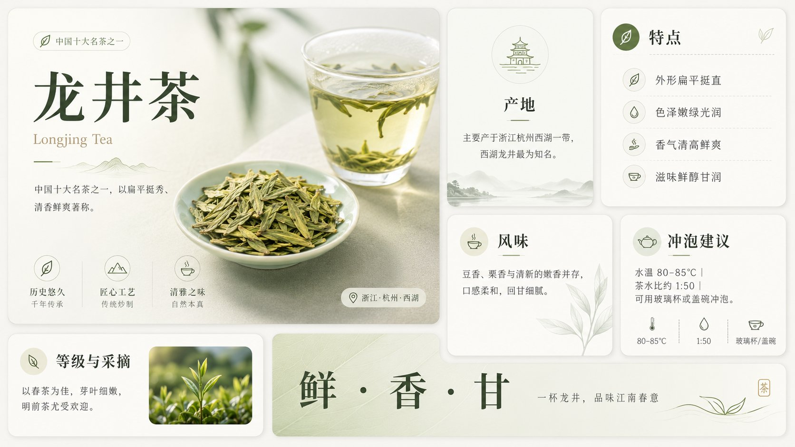
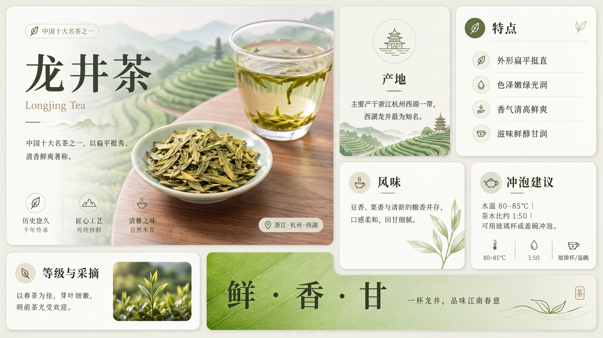

## 用 Nano Banana 重绘清晰化 GPT 图片

### 概述

GPT 生成的图片很多时候会有毛躁感和破碎的纹理，一眼就能看出来。可以用 Nano Banana 去放大 GPT 生成的图像，去掉无意义的细节，让文字和细节更锐利、更清晰。

来源：[X 原帖](https://x.com/op7418/status/2068239294372987378)

### 适配模型

- Nano Banana

### 示例

### 提示词

帮我将这张图片重绘和清晰化，让他细节更丰富，同时去掉原图中杂乱不必要的细节
