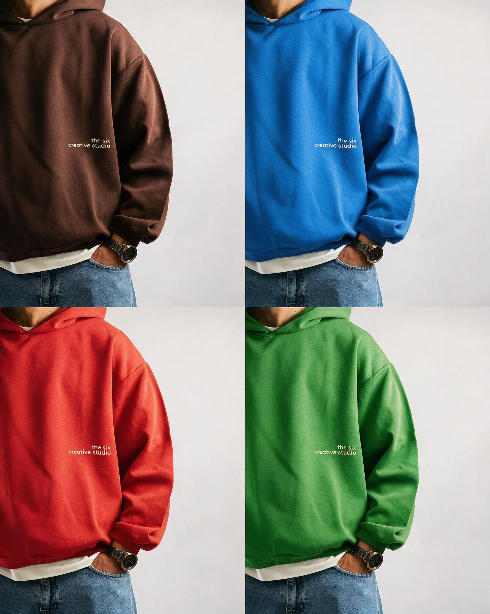

## Seedream 5.0 Pro 精细编辑提示词

### 概述

Seedream 5.0 Pro 的可编辑能力：在图上打点（@Mark）、画框（@Region）、传参考图（@Image），提示词里直接 @ 出来，你指哪它改哪。下面是测评里家装、商品图、海报排版三个场景用到的提示词，需要在火山引擎 Lumina 平台的 Draw 编辑里先做好标记。

来源：[X 原帖](https://x.com/op7418/status/2076604797202161800)

### 适配模型

- Seedream 5.0 Pro

### 示例



### 提示词

#### 出租屋打点换装

```
帮我生成一张出租屋装修后的设计示意图，将 @Mark01 换成米白布艺沙发，将 @Mark02 的墙面刷成 #F5EDE3 的漆，将地板换成 @Mark03 鱼骨拼原木地板，将 @Mark04 的货架换成宜家的木质货架，并且整理脏乱的衣物和杂物
```

#### 参考图替换家具

```
将 @Mark01 的沙发替换为 @Image002，将 @Mark02 的茶几替换为 @Image004，将 @Mark03 的躺椅替换为 @Image003，将 @Mark04 的置物柜替换为 @Image005，同时去掉 @Mark05 的晾衣架和杂物，将 @Mark06 的窗帘替换为 @Image006
```

#### 色卡配色

```
参考我给的色卡 @Image002，给这个房间 @Image001 重新配色：墙面用最浅的那个色，窗帘用第二个色，柜子和茶几换成对应颜色的家具，家具位置全部不变，去掉杂物
```

#### 商品图场景大片

```
把这个键盘放到清晨的木质工作桌场景，旁边有面包和一杯茶，逆光，键盘上的文字保持原样不能变
```

#### 爆炸拆解图

```
加一个爆炸拆解视角展示键盘的内胆结构
```

#### 拆解图标注卖点

```
底座位置标注：铝合金一体成型；键盘轴位置标注：高端磁轴；键帽部分标注：精品键帽；最下方氛围灯部分标注：多彩炫彩氛围灯
```

#### 画框排版海报

```
@Region01 位置写上大标题：magnetic speed. mechanical soul.，@Region02 位置写上副标题：Lofree HYZEN67，@Region03 用一张大卡片悬浮在上面展示三个键盘的特色文字要点的排版，文案分别是：CNC-Milled From a Single Block of Aluminum.、solving the 65% keyboard limitation. visibility f-row mode indicators.、architectural precision, a defined shape built for performance.
```

#### 服装换色四宫格

```
这件卫衣分别改成 #1E8BE5、#E53935、#4CAF50 三个颜色，版型、褶皱、光影、背景全部不变，算上原来的颜色出一张四宫格效果图
```

#### 白底排版稿 + 产品图生成海报

```
严格按照图一的文字内容和排版位置，生成一张海报：整体是奶咖色系（#C8A27A、#4A3728），标题做成奶油挤出来的立体质感，产品放在版面中下部，光线是咖啡馆的暖光。所有文字内容和位置严格遵循图一，一个字都不能改。
```

#### 同一版式换标题材质

```
严格按照这张宣传图的排版和细节，将宣传图中的标题和副标题分别改成毛毡缝线质感、金属镭射 Y2K 质感和宣纸水墨的质感，然后做一个四宫格，算上原来的原图放在一起。
```
