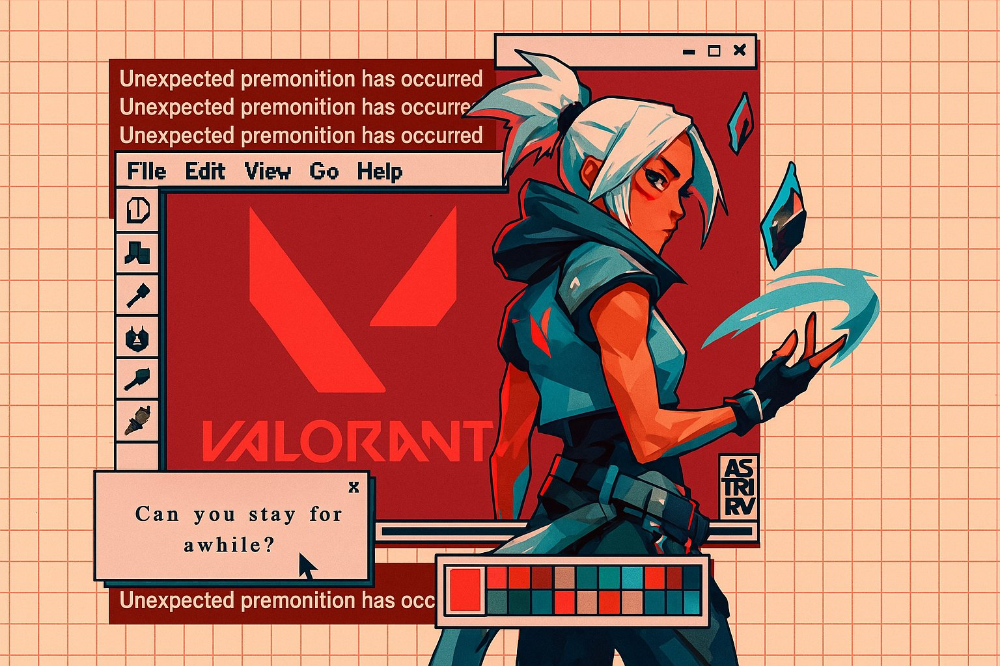
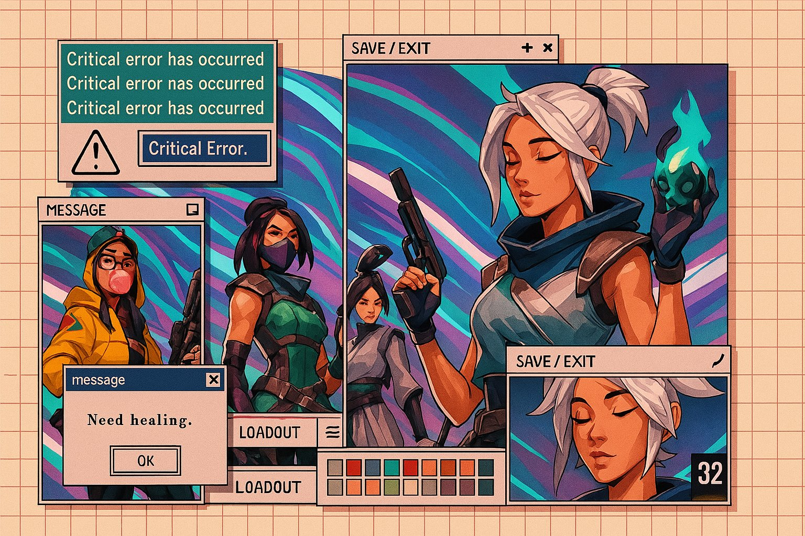
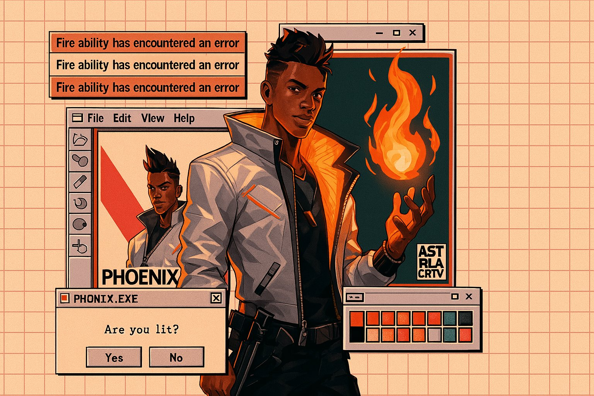
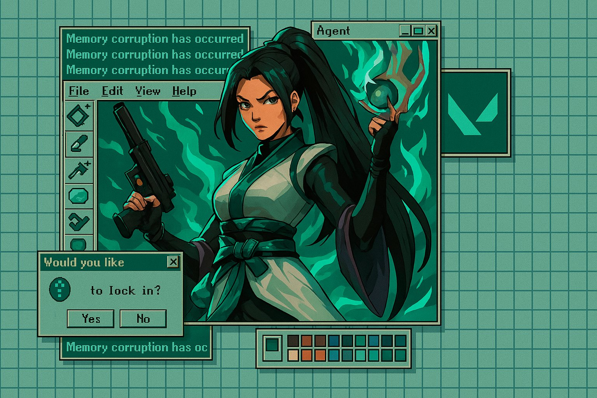

## Windows 2000 窗口拼贴画

### 概述

搞了一个 4o 的新风格

Windows 2000 窗口组成的复古平贴画，最近这种复古界面又开始火了

可以找任何你喜欢的图片或者角色垫图做

来源：[X 原帖](https://x.com/op7418/status/1911318720003383743)

### 适配模型

- GPT-4o

### 示例






### 提示词

```
先将我上面的图放在第一张

将第二张{Valorant游戏}的图片的{角色}和配色，跟第一张图片的表现形式和风格结合生成新的3:2比例的图片。  
注意UI要模仿千禧年 Windows 界面，同时界面内容需要跟{角色}相关
```
