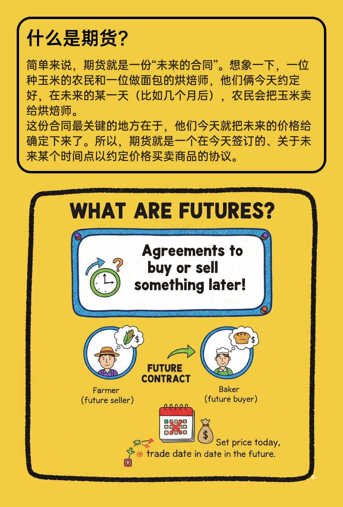
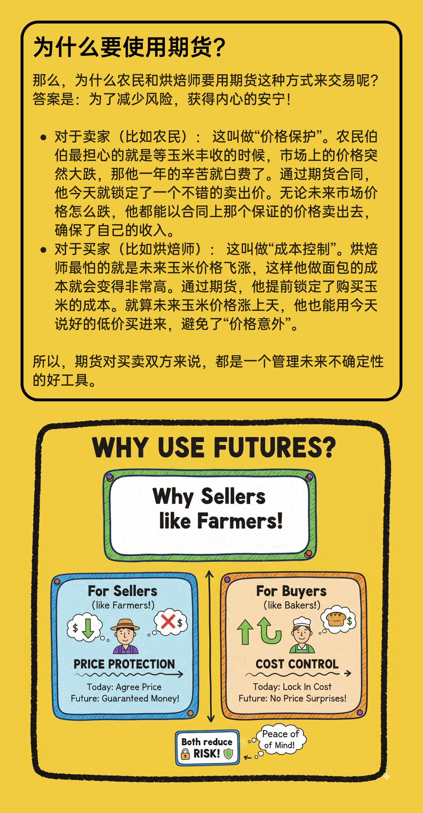
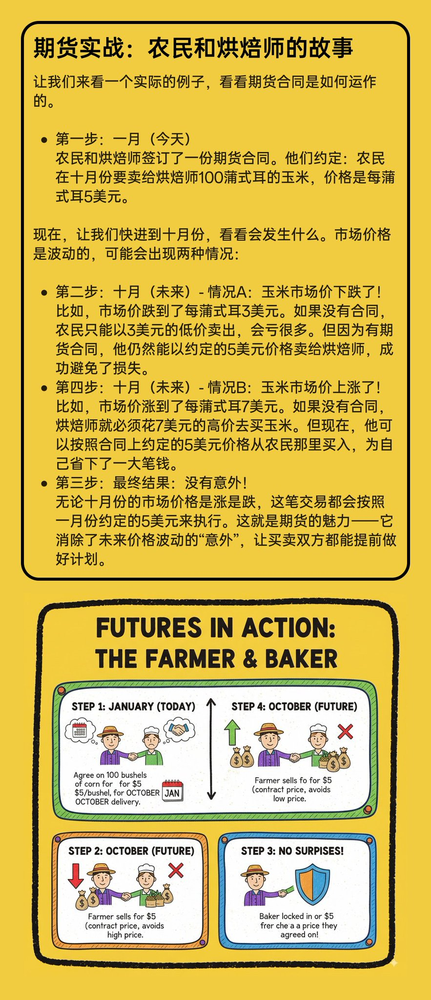
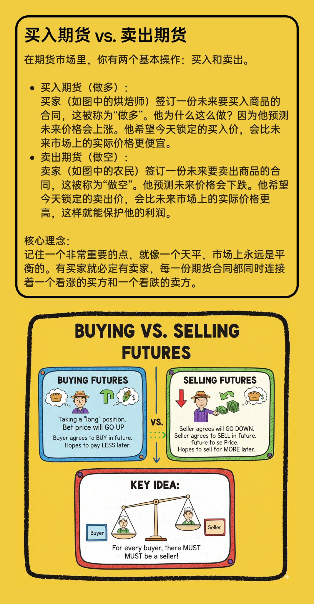

## 一图读懂概念涂鸦图

### 概述

大聪明（赛博禅心）刚才发了个 Nano Banana 一图读懂XXX的提示词

非常适合用来学习和解释一些概念，浅显易懂

但他那个是针对 Lovart 搞的，我优化了一下，现在单独用Nano Banana也可以稳定生成，而且排版更加一致

下面👇是提示词

来源：[X 原帖](https://x.com/op7418/status/1961811274683310110)

### 适配模型

- Nano Banana

### 示例






### 提示词

```
Help me generate multiple 16:9 doodle-style images to explain the concept of "futures" to middle school students. The images should have a consistent colorful, thick-pencil hand-drawn style, be rich in information, feature English text, use solid color backgrounds, have outlines around the cards, and include uniform titles, similar to a PowerPoint presentation.
```
