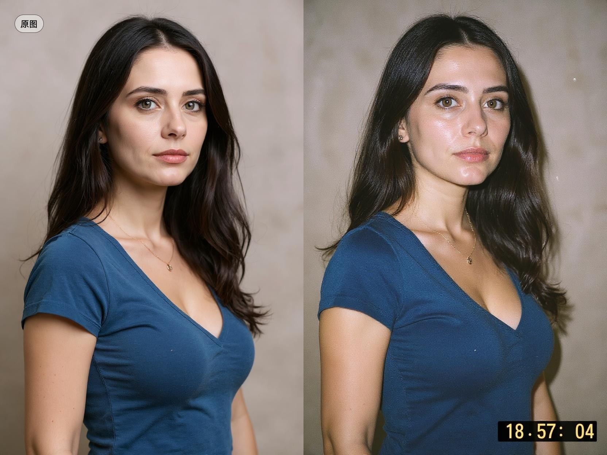

## 一次性相机胶片滤镜

### 概述

FLUX Kontext 也能完成给照片套滤镜的工作

来源：[X 原帖](https://x.com/op7418/status/1930101936776437990)

### 适配模型

- FLUX Kontext

### 示例



### 提示词

```
Change to a lo-fi film style from a disposable camera, with mild film grain, light leaks, and a timestamp reading '18:57:04'.

可以多试几次，有时候图片没变化
```
