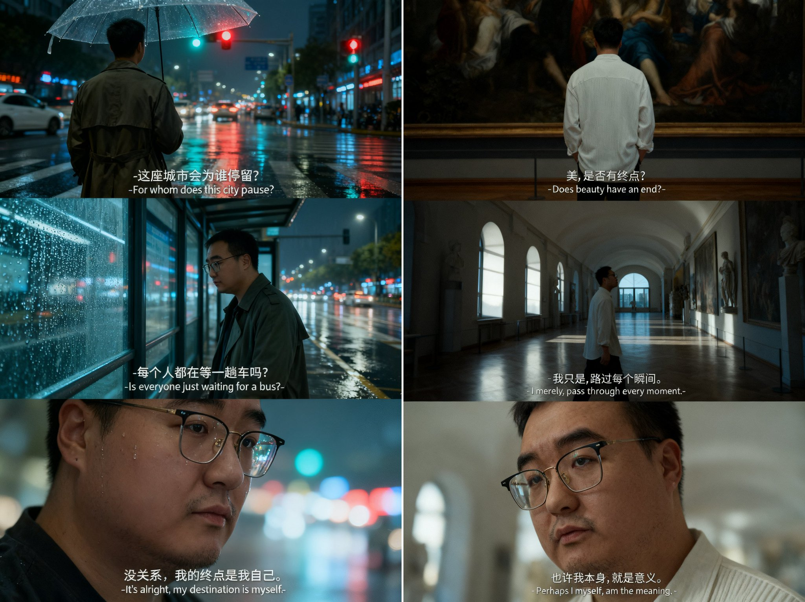

## 三宫格胶片氛围人像

### 概述

最近抖音很火的即梦或者豆包直出三宫格氛围人像照片

只需要拿你的照片加上提示词就能搞定，建议用 2:3 比例

来源：[X 原帖](https://x.com/op7418/status/1980308680001421541)

### 适配模型

- 即梦
- 豆包

### 示例



### 提示词

```
提示词 1：

一张以图片人像为主角的三宫格胶片质感艺术感写真图,场景为清晨安静的图书馆,阳光从高窗斜射进来。
图中人物和参考图一致,人物和脸不变,衣服为简单的白色毛衣。第一张为近景,上半身背影,人物站在高大的书架前,仰头寻找一本书,添加中英字幕“故事都写在书里吗？-Are all the stories written in books?-”第二张为中景,人物侧身坐在窗边的桌前,阳光照在翻开的书页上,低头看书,添加中英字幕“我好像…读到了别人的脚本。-I seem to be... reading someone else's script.-”第三张为大特写,人物脸部位于画面偏左侧,合上书本,眼神平静地望向窗外的光,添加中英字幕“我的故事,从这一笔开始。-My story begins with this stroke.-”整体色调清冷,带有富士胶片效果,过度曝光,画面粗粝且色调偏冷,暗部细节保留完整,高光区域呈现自然晕化、均采用柔和漫射光,无明显硬边阴影,营造出文艺且充满自我探索情绪的氛围,三张图合成一个三宫格,字幕位于底部居。

提示词 2：

一张以图片人像为主角的三宫格胶片质感艺术感写真图,场景为古典美术馆的空旷走廊,早晨或傍晚,光线透过拱形窗户洒在地板上。
图中人物和参考图一致,人物和脸不变,衣服为简约款的白色针织衫或衬衫。第一张为近景,上半身背影,人物站在一幅巨型画作前,双手插兜,背影显得修长而有艺术气息，添加中英字幕“美,是否有终点？-Does beauty have an end?-”第二张为中景,人物侧身走在长廊上,目光落在墙壁上的雕塑或另一幅画上，光影勾勒出侧脸的轮廓，优雅而富有吸引力，添加中英字幕“我只是,路过每个瞬间。-I merely, pass through every moment.-”第三张为大特写,人物脸部位于画面偏左侧,微抬下巴,眼神略带疑惑却又充满好奇,仿佛在与艺术品对话，展现出一种知性的帅气，添加中英字幕“也许我本身,就是意义。-Perhaps I myself, am the meaning.-”整体色调清冷,带有富士胶片效果,过度曝光,画面粗粝且色调偏冷,暗部细节保留完整,高光区域呈现自然晕化、均采用柔和漫射光,无明显硬边阴影,营造出文艺且充满探索与沉静的氛围,三张图合成一个三宫格,字幕位于底部居中。

提示词 3：
一张以图片人像为主角的三宫格胶片质感艺术感写真图,场景为霓虹闪烁的城市街道,刚下过雨,地面湿润反光。
图中人物和参考图一致,人物和脸不变,衣服为风衣,撑着一把透明的伞。第一张为近景,上半身背影,人物撑伞站在路口,看着对面的红绿灯和穿梭的车流,添加中英字幕“这座城市会为谁停留？-For whom does this city pause?-”第二张为中景,人物在公交站台的玻璃后,侧身看着玻璃上的雨滴,添加中英字幕“每个人都在等一趟车吗？-Is everyone just waiting for a bus?-”第三张为大特写,人物脸部位于画面偏左侧,,脸颊上有一滴分不清是雨水还是泪水的水珠,眼神平静地望向镜头外的霓虹,添加中英字幕“没关系，我的终点是我自己。-It's alright, my destination is myself.-”整体色调清冷,带有富士胶片效果,过度曝光,画面粗粝且色调偏冷,暗部细节保留完整,高光区域呈现自然晕化、均采用柔和漫射光,无明显硬边阴影,营造出文艺且充满自我探索情绪的氛围,三张图合成一个三宫格,字幕位于底部居中
```
