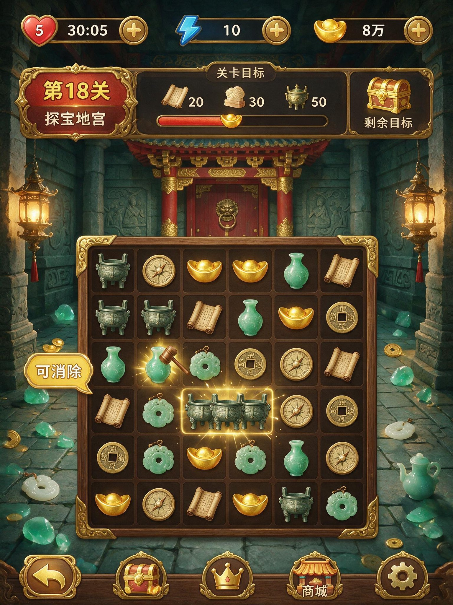

## 中国古代探宝三消游戏 UI

### 概述

同样是 Seedream 5.0 上线时的测试，一句话生成一个中国古代探宝风格的三消游戏 UI 设计图。

来源：[X 原帖](https://x.com/op7418/status/2074862226905948549)

### 适配模型

- Seedream 5.0

### 示例

### 提示词

帮我生成一个游戏 UI 设计图：是一个中国古代探宝风格的三消游戏
