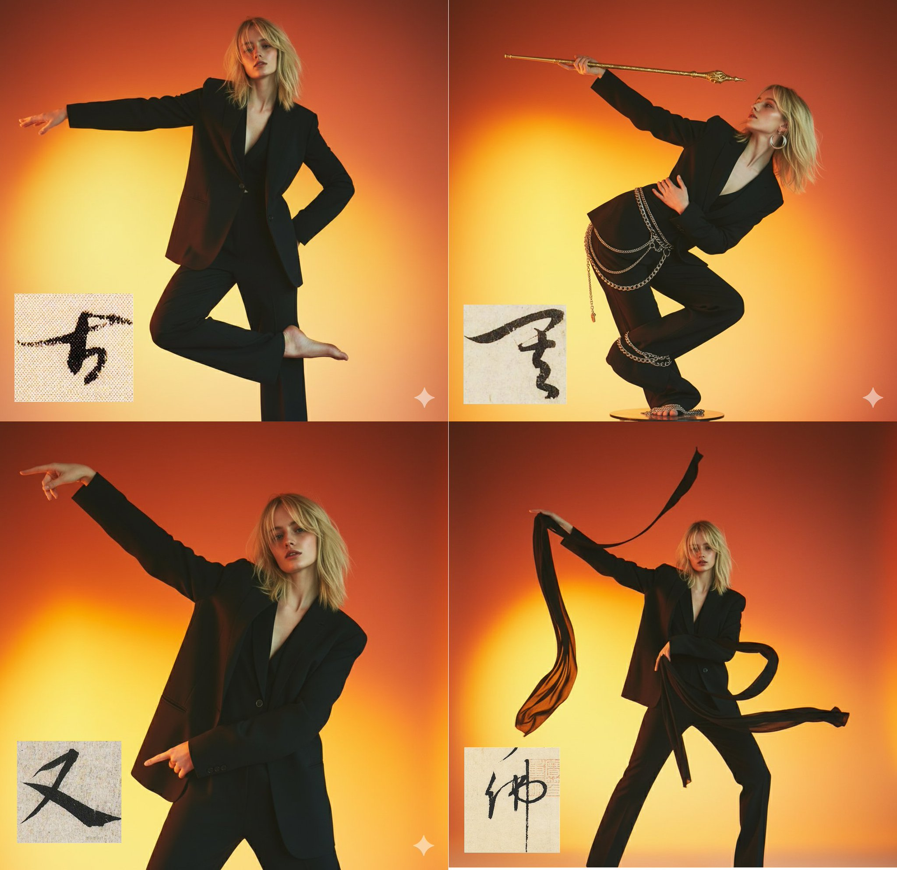

## 人物摆出汉字姿势

### 概述

Nano Banana 居然可以让角色摆出类似汉字的姿势？

刚才看到一个 B 站 UP 自己自己摆出类似汉字的姿势跳舞

Nano Banana 姿势参考也很强，就拿视频里面的字符试了一下，没想到真行啊，太猛了

来源：[X 原帖](https://x.com/op7418/status/1961714432842813686)

### 适配模型

- Nano Banana

### 示例



### 提示词

```
将图 1 中的人物改为与图 2 字符相似的全身姿势，生成的图片不要有字符，必要时可以用配饰辅助
```
