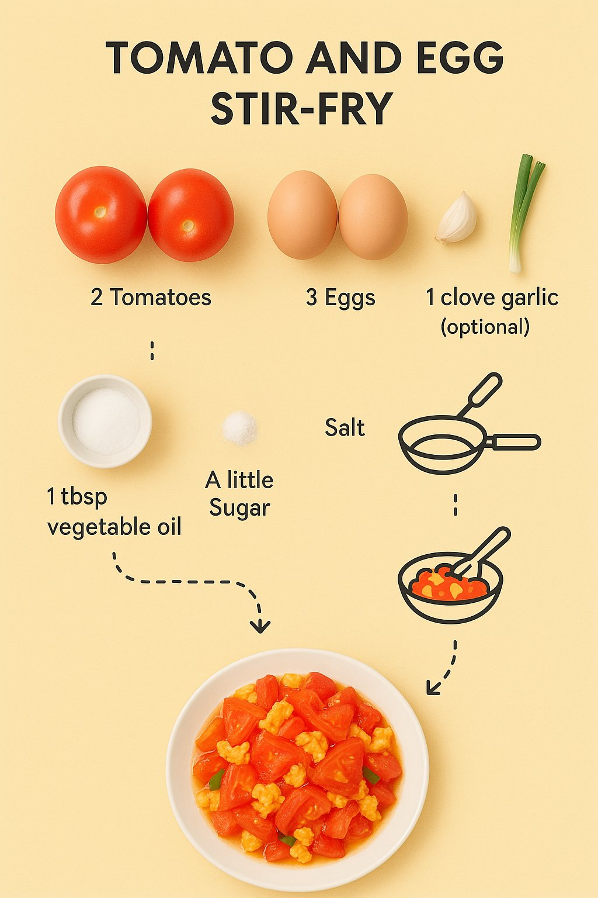

## 分步食谱信息图

### 概述

GPT-4o制作的食谱图片，让他做了一个西红柿鸡蛋的挺像那么回事。

制作方式，换个菜名让AI根据下面的提示词

来源：[X 原帖](https://x.com/op7418/status/1906308579554156797)

### 适配模型

- GPT-4o

### 示例



### 提示词

```
为西红柿炒鸡蛋创建一个分步食谱信息图，要求：

采用俯视视角。
在白色背景上呈现极简风格。
包含标注好的食材照片，例如：“2个西红柿”、“3个鸡蛋”、“1瓣蒜”（可选）、“1根葱”、“1汤匙食用油”、“盐”、“少许糖”（可选）。
使用虚线连接代表制作步骤的图标（例如：打蛋碗图标、炒锅图标、混合/翻炒图标）。
信息图底部展示最终装盘的西红柿炒鸡蛋成品照片。
```
