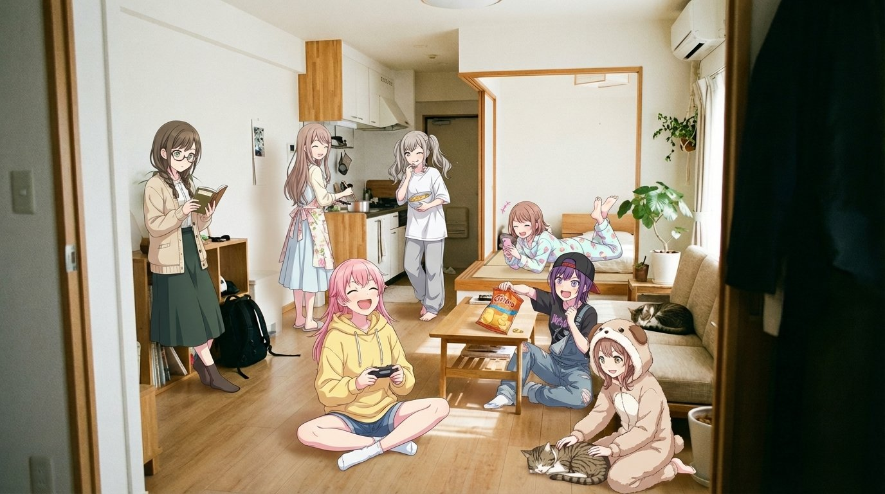

## 动漫少女走进写实房间

### 概述

Nano Banana Pro 爆款玩法，原推五十万曝光了

多个动漫少女在一个写实房间，看起来超级温馨。

而且还有打破次元壁的感觉，你的纸片人老婆出来陪你的感觉

来源：[X 原帖](https://x.com/op7418/status/1991891018481009024)

### 适配模型

- Nano Banana Pro
- Gemini

### 示例



### 提示词

```
具体的操作：

1️⃣先自己生成一张写实风格的没有人的照片。

2️⃣然后将这张没有人的照片和下面的提示词一起发给 Gemini：

请帮我写一段 AI 绘画提示词。 基础要求： 基于这张图片的背景，添加【X个】动漫人物，氛围要【热闹/安静/活泼】。 输出格式： 请分行详细描述每个人的【装扮 + 动作表情 + 所在位置】，直接给我中文描述。

3️⃣最后在他生成的提示词前加上：

为这个写实的实景场景房间添加多位性格各异的动漫风格女孩，确保房间是写实风格，只有少女为动漫风格。
```
