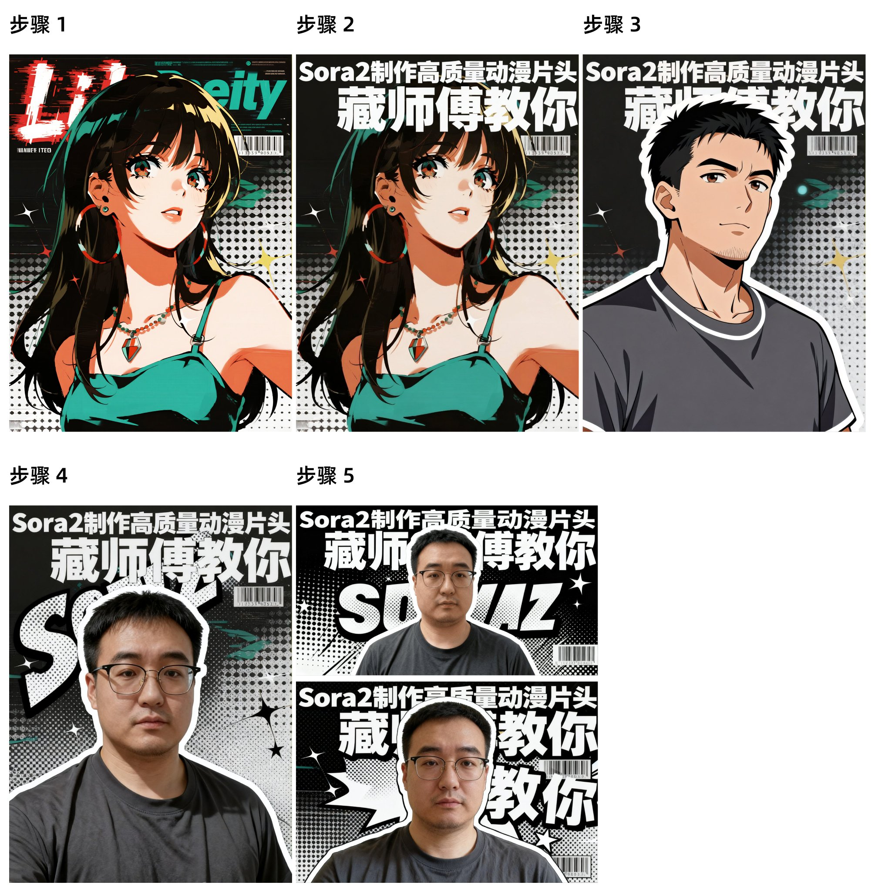

## 动漫杂志风视频封面

### 概述

即梦 4 用来做视频封面真是一绝！

用我昨天探索的动漫杂志风格提示词改了一个视频封面，点击率非常高，

来源：[X 原帖](https://x.com/op7418/status/1977574988153761929)

### 适配模型

- 即梦 3.1
- 即梦 4.0

### 示例



### 提示词

```
步骤 1：
先用即梦 3.1 和这个提示词生成你喜欢的图片：将照片角色转换成动漫美女，美学风格非常现代且充满活力，像动态的杂志版面或波普艺术。将高对比度的人物剪影与半色调图案以及大量动感排版相结合，没有文字

步骤 2：
上传你选好的图片，输入提示词为它增加文字，这个时候模型要换成即梦 4：在图片在上方增加留白和优秀的艺术文字排版，替换原有的文字：“Sora2制作高质量动漫片头”“藏师傅教你”，文字跟图片融合的很好

步骤3：
上传你的真人照片和步骤 2 的结果图，替换原来的动漫角色，这时候是动漫风格的：图片的人物替代图 1 的动漫角色，为人物加上白色描边

步骤 4：
如果需要真人风格，上传步骤 2 结果图和你的真人照片，使用提示词：图片的人物替代图 1 的动漫角色，保证人物的写实风格，同时在人物后方增加一些网点和波普艺术排版元素，为人物加上白色描边

步骤 5：
如果需要更多比例的封面图片的话，重复步骤 4 切换生成图片的比例就行
```
