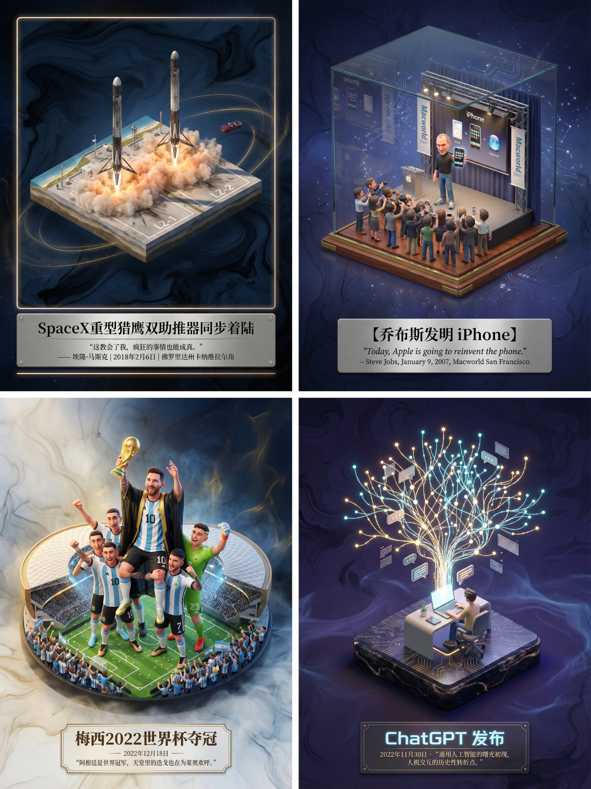

## 历史事件博物馆微缩海报

### 概述

还能用这种方式制作真实历史事件的海报

可以将你偶像的高光时刻或者人类的高光时刻画出来，对于我们很多人都非常有意义！

改了一下提示词，依然很顶！Nano Banana Pro 确实猛。

比如 2022 梅西夺冠、乔布斯发布 iPhone、ChatGPT 发布

来源：[X 原帖](https://x.com/op7418/status/1998434974186586128)

### 适配模型

- Nano Banana Pro

### 示例



### 提示词

```
请为【SpaceX重型猎鹰双助推器同步着陆】制作一张博物馆级别的3D轴侧微缩海报，先检索相关信息获取知识。

第一步，智能识别与场景构建： 请先调用你的知识库，判断我输入的主题属于哪种类别（是虚构文学、真实历史事件、体育竞技还是科学发现）。 然后，精准检索该主题发生时的具体环境、核心人物动作、服饰细节以及当时的气候氛围。 在画面中央，建立一个精致的3D微缩场景模型。风格上，保持梦工厂动画那种高精度的材质感和柔和的光影渲染。 如果是体育，要强调动作的爆发力和凝固的瞬间感；如果是历史，要还原年代感和严肃性；如果是文学，则强调意境。

第二步，氛围与背景： 背景请摒弃纯白，使用带有极淡水墨纹理和流动光雾的虚空环境，色调根据主题自动调整，营造出一种“历史切片”或“珍贵藏品”的高级感。

第三步，排版与文字： 在底部居中位置生成中文排版。 主标题写上事件或作品的名称，字体设计要契合主题风格。 在标题下方，请自动检索该事件最著名的金句、解说词、日期或历史评价，字体使用优雅的衬线体。整体布局要像一个高级的博物馆藏品铭牌那样精致平衡。
```
