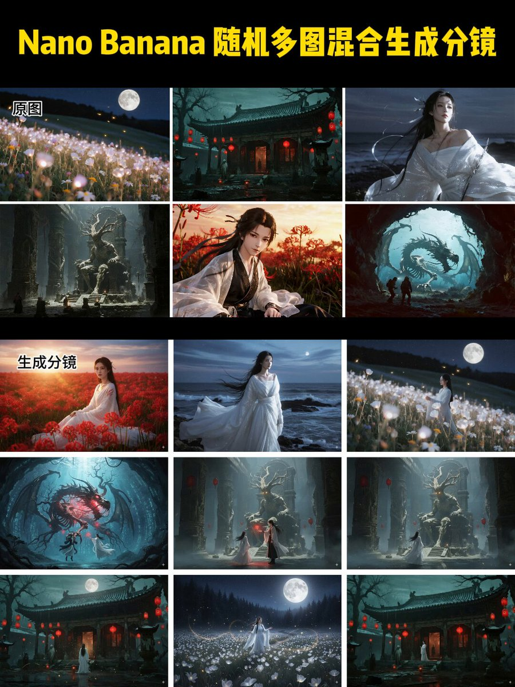

## 参考图生成连续故事分镜

### 概述

Nano Banana 的一致性真的猛

搞了一个提示词，随便给他几张图，他就能参考图片画风和角色给你生成连续的故事分镜图片

而且美学表现、场景、人物的一致性都可以保证

然后直接可灵 2.1 首尾帧或者即梦的智能多帧就是一个视频了

来源：[X 原帖](https://x.com/op7418/status/1963163922342523023)

### 适配模型

- Nano Banana

### 示例

原帖为视频，下图为视频封面截图。



### 提示词

```
Help me generate a storyboard with a story based on these images. 

Extract the scenes and characters from these images and recombine them to generate 6 continuous storyboard panels with a storyline. 

The art style of the new images needs to be consistent with the original images provided. There should be no text or markings on the images. 

The story needs to be unconventional, and please also provide suggestions for accompanying music
```
