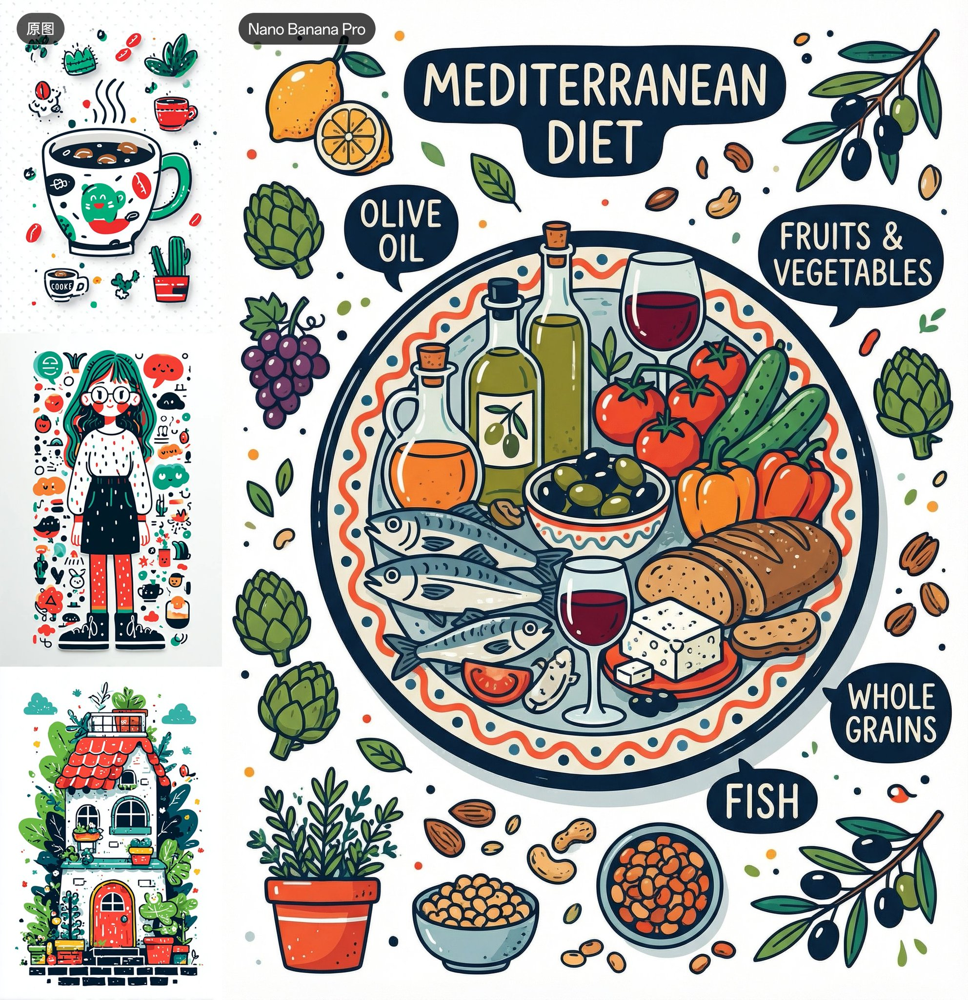

## 参考图风格迁移示意图

### 概述

Nano Banana Pro 的风格迁移能力非常强大！

你完全可以给他几张 Midjourney 相同风格的图片让他生成其他内容

比如这里我就让他参考图片风格生成了一张地中海饮食的示意图

来源：[X 原帖](https://x.com/op7418/status/1995337868181717248)

### 适配模型

- Nano Banana Pro

### 示例



### 提示词

```
请帮我参考这三张图片的风格，绘制一张地中海饮食示意图
```
