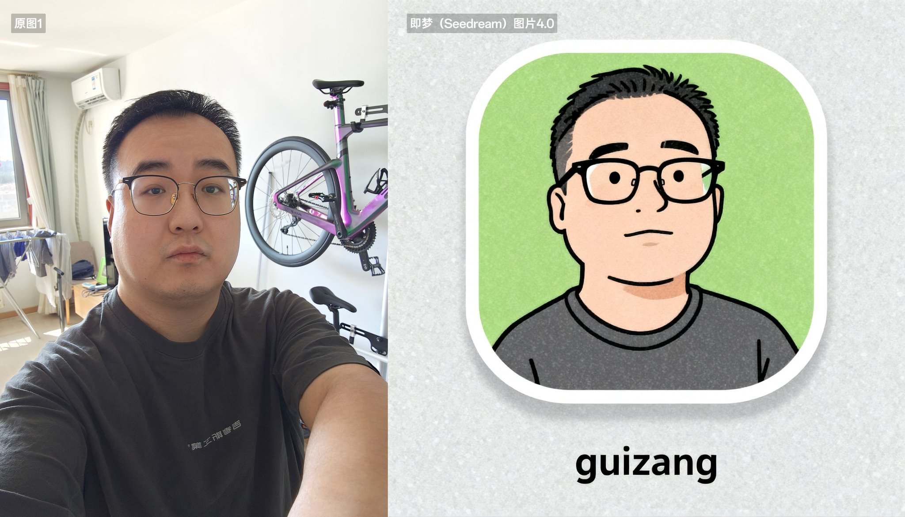

## 参考画风生成头像图标

### 概述

用即梦 (Seed dream) 4 图像模型给自己做一个非常有质感的头像

这还原的也太好了，关键的 ID 要素都还原了，而且有那种非常有质感的笔触效果

来源：[X 原帖](https://x.com/op7418/status/1964564636063453446)

### 适配模型

- Seedream 4.0

### 示例



### 提示词

#### 提示词 1

```
参考图一的风格和样式为图2的角色生成一个图标，图标下方的文字应该为“guizang”

垫了下这个画头像老哥的图，注意自己玩可以不要盈利哈，尤其是垫图这种方式
```

#### 提示词 2

```
参考图1的风格和样式为图2的角色生成一个图标，同时只要参考图2的头部位置，像一个头像图标，图标下方的文字应该为“Jinx”
```
